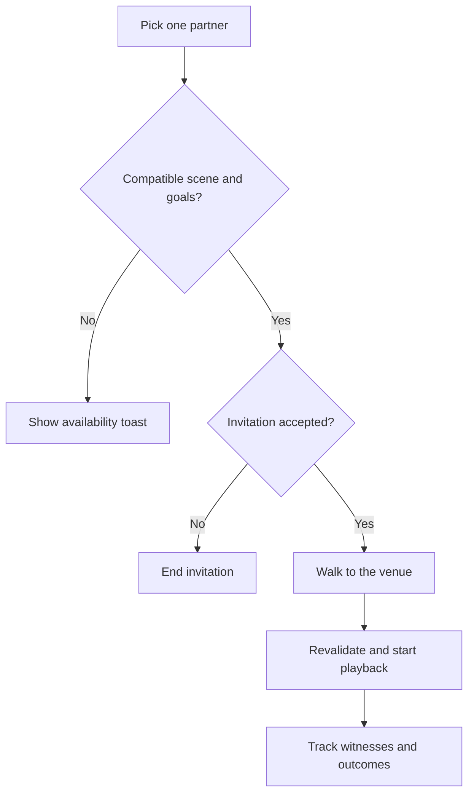

# HZoi Gameplay encounter design

**Status:** Proposed, iteration 1

HZoi Gameplay owns invitations, venue selection, witness reactions, and gameplay consequences. SceneZOI owns placement, playback, task progress, and cleanup. Installed content packs determine which pairs and venues can play a scene.

## Player interaction

Add **Have sex here** with a burning-heart icon to SceneZOI-supported beds and sofas and to walkable ground. Show it for a Young Adult or older initiator. Apply the same eligibility rule to picker candidates.

Keep eligibility in one easily configurable rule, because mods or updates may possibly add life stages. An unknown stage needs an explicit "is eligible" mapping. Ghosts are handled through separate native life-state interfaces, and supernatural Zois (likely coming from mods) such as a succubus, a vampire, an alien, may be implemented similarly. [Growth step enum](https://mod-docs.playinzoi.com/docs/modkit-docs/wiki/structguide/enum/eb1growthstep/) · [Life component](https://mod-docs.playinzoi.com/docs/modkit-docs/wiki/luaapi/b2/components/fb2lifecomponent/).

Open a picker patterned on SceneZOI’s debug starter. The initiator is fixed and the player selects one partner. Keep the roster representation compatible with more roles for later packs. The picker should return a selection without starting playback or causing the debug starter’s gameplay-group departures. [SceneZOI picker and group behavior](https://github.com/acepleiades/SceneZOI/blob/main/docs/group-support.md#solo-launcher-and-debug-picker).

### Content check and invitation

Resolve the actual roster, role bindings, and selected venue before the invitation. Require a compatible route to one `excitement` completion for each Zoi. The current content is expected to cover male/female pairs. Let male/male and female/female pairs reach the same check and show **No compatible scenes are available for these Zois at this spot** when no route exists. Content updates can enable those pairs without a gameplay rule change. Handle busy Zois, occupied furniture, and unreachable locations as temporary availability failures.

The initiator walks up and proposes the encounter using the **Set the Mood** conversation. Match the current build’s eligibility conditions, branch order, and acceptance/refusal weights from `Co_TryTo_Mood_Lover` and `Co_TryTo_Mood_Spouse`. Reuse the native social rules and approach dialogue. HZoi’s venue and adult-eligibility checks supply the equivalent context for ground and supported furniture. End the invitation on refusal. On acceptance, have both Zois walk to separate arrival points at the selected venue. Recheck eligibility, path arrival, and furniture availability before requesting playback. [Vanilla romance reference](inzoi-romance.md) · [Interaction branches](inzoi-romance-interactions.csv).

## Playback and consequences

Use `start_autonomous_scene` for both player- and NPC-initiated encounters. Request one `excitement` completion per participant, one stage, and `end_policy = {type = "goals"}`. Auto-mode already exits after both goals, authored completion responses, and any configured `post_completion_stay_seconds`. Manual takeover suspends planned exit. Keep the ordinary Exit control available. For furniture, pass `furniture_id` and the chosen `furniture_pair_id` for sofas. For ground, route the scene’s anchor-role Zoi to the clicked point. Current starts derive the ground anchor from a participant. Verify whether automatic placement adjustments stay within the chosen venue before deciding whether an explicit world anchor is needed. [SceneZOI start and plan API](https://github.com/acepleiades/SceneZOI/blob/main/docs/addons.md#autonomous-scenes).

Correlate `session_started` with the original request. Read per-Zoi `plan.goals` and `result_facts.task_state` on `session_ended`, with `get_session_result` for a missed event. Apply final moodlets once after cleanup. Process needs and urge fulfillment during playback. Keep the stop reason alongside the completion counts. A missing result leaves any unobserved outcome unknown. [SceneZOI outcomes](https://github.com/acepleiades/SceneZOI/blob/main/docs/addon-controls.md#observation-and-outcomes).

Action-specific urges, contraception, and pregnancy effects stay out of iteration 1.

### Needs on each Excitement completion

The live v0.11.2 bed sequence gives each Zoi the three costs through `Delay_30_MakeLove → MakeLove_AddStat` and the two gains through `Co_TryTo_Mood → Mood_Success`. The separate, conditional `Co_Mood_After` follow-up adds 10 Fun and 10 `Admit` to both Zois. Use the main interaction's five deltas for this milestone.

| Need | Native delta per Zoi | HZoi delta per completion |
| --- | ---: | ---: |
| Hunger (`Hunger`) | −50 | −12.5 |
| Hygiene (`Cleanliness`) | −50 | −12.5 |
| Energy (`Energy`) | −50 | −12.5 |
| Fun (`Fun`) | +10 | +5 |
| Social (`Society`) | +10 | +5 |

Apply the deltas during playback to the Zoi who completed the task. Each completion is independent of the other Zoi's result and of the eventual stop reason. Deduplicate using session ID, participant ID, task ID, and completion index. For a cost, apply at most the amount available above 33% of the configured need range. On the current −100 to +100 scale that floor is −34. A protected need already at or below 33% stays at its current value when HZoi applies the costs. Gains cap at the need maximum. Read the current value at each completion and verify the write path preserves the clamp even with native modifiers. Let natural decay continue throughout the scene, including below 33%. [SceneZOI completion events](https://github.com/acepleiades/SceneZOI/blob/main/docs/scene-tasks.md#completion-and-subscriptions) · [Native stat interface](https://mod-docs.playinzoi.com/docs/modkit-docs/wiki/luaapi/b2/components/fb2statcomponent/) · [AddStat rules](https://mod-docs.playinzoi.com/docs/modkit-docs/wiki/script-execution/exec-addstat/).

## Urges and NPC initiative

The game stores Urges as `Hope` rows with owner and target conditions, a lifetime, a cooldown group, and a mission. The closest match in the live build is `Trait_Needy_LoveLover`. It selects for an awake Emotionally Needy Zoi with a named lover, outside a rabbit hole, prison, site event, and the desert island. Its target must pass romantic eligibility and be a named lover at Romance below 30. The native row has a 12-hour lifetime and the `HopeCool_2Day` group. Its target-bound mission counts one `Event_MakingLove` talk. Carry those conditions over as the initial HZoi urge rules and apply the Youth-or-older policy to both Zois. For an NPC's invitation, also require the ordinary **Set the Mood** invitation rules and a feasible private venue. The urge makes a valid invitation more likely and can remain pending while a venue is unavailable. [Krafton's Urge selection notes](https://playinzoi.com/en/news/9309) · [Hope component](https://mod-docs.playinzoi.com/docs/modkit-docs/wiki/luaapi/b2/components/fb2hopecomponent/).

Store the urge owner, selected partner, and expiry. Subscribe to `task_completed`. Satisfy the active urge during the scene when the **owner** completes `excitement` and the **selected partner** is in that scene. Either Zoi can initiate. Acceptance, walking to the venue, or a completion by only the partner leaves the urge active. A later interruption leaves an earned completion intact.

Prototype a custom `Hope` and target-bound mission completed by a SceneZOI event. Probe `RequestAddSpecificAvailableHopeSingle` for selection, then inspect `GetSelectedHopes`, the slot's `ReasonTargetEntityId`, and the mission's `TargetEntityId` before testing the `OnFinishMission` handoff with the real mission ID. Verify the native UI updates, rewards are granted once, and the cooldown applies. If the native completion hook cannot service the custom mission, keep the partner-specific state and fulfillment in HZoi. [Hope component](https://mod-docs.playinzoi.com/docs/modkit-docs/wiki/luaapi/b2/components/fb2hopecomponent/) · [Native mission state](https://mod-docs.playinzoi.com/docs/modkit-docs/wiki/luaapi/b1/structs/fb1missionstate/).

## NPC privacy and venue selection

For autonomous invitations, search reachable private rooms on a residential site, preferring rooms meant for privacy such as bedrooms. Require vacancy except for the two participants. Public rooms, common circulation, and unclassified space are outside the NPC search. Player-directed venue choice keeps its existing rules.

1. First rank vacant rooms with a free supported bed or sofa and a compatible scene route for this pair. A sofa needs a free compatible seat pair. Prefer the nearest reachable room among valid candidates in this tier.
2. If none qualify, search vacant private rooms without supported furniture for a walkable ground anchor and a compatible standing route. Skip the attempt if neither tier has a valid candidate.

Use `find_furniture` for compatibility and furniture occupancy. Use `FB2Site:IsSameRoom` with the venue point and loaded Zois' positions for room occupancy, plus floor and residential-site checks. A read-only `build.scan_floors` call on the live apartment returned room geometry. Room purposes, interior boundaries, and path/access checks still need a runtime probe. A free bed alone establishes furniture availability. [Site API](https://mod-docs.playinzoi.com/docs/modkit-docs/wiki/luaapi/b2/structs/fb2site/) · [Room scan](https://mod-docs.playinzoi.com/docs/modkit-docs/wiki/cli/build/build-scan-floors/).

Watch the reserved room while the NPC pair walks there and check again immediately before start. If another Zoi enters before playback, cancel the attempt and release the venue. Have the NPC initiator show a localized overhead complaint chosen from a random pool, such as “Can’t we have a little private time?”, “They walked in at the worst moment,” or “I thought this room was empty.” A second line from the partner is optional and can use the same pool. Existing `SpeechBubble` rows and `AddSpeechBubble` support this presentation. Room intrusion before playback leaves the urge pending. Keep concurrent attempts independent and recheck participant and seat availability at arrival. [Native speech bubbles](https://mod-docs.playinzoi.com/docs/modkit-docs/wiki/script-execution/exec-addspeechbubble/).

**Vanilla comparison.** The reported **Suggest Having a Baby** attempt worked after the player cleared the bedroom and invited Seoyun in the living, dining, and kitchen area. The inspected `CanPregnancy_NoSpouse` condition has a double-bed presence check. The sequence then finds a bed through `AutoFind_Double_Bed` and `Sleep_Bed`. The inspected rows expose no room-vacancy predicate, so the toast's cause remains unresolved, maybe the NPCs in the room had been occupying the path. A controlled retry should change room occupancy alone, verify the same bed and slots are available, and capture the exact toast and failed sequence step. Empty rooms are HZoi's NPC venue policy.

## Witnesses and cheating

Check loaded Zois outside the roster during a currently playing intimate action, including Zois who arrive late. Use the directed action and participant IDs from `Client.actions(snapshot)`. Require an actual sight trace from the witness's viewpoint to the encounter. Use proximity only to bound candidate searches. A blocked or unavailable trace leaves the encounter unwitnessed. Verify the native trace against walls and closed doors across both camera and simulation states. [SceneZOI witness example](https://github.com/acepleiades/SceneZOI/blob/main/docs/addon-authoring.md#a-romantic-partner-catches-the-encounter) · [Native trace API](https://mod-docs.playinzoi.com/docs/modkit-docs/wiki/luaapi/b1/classes/ub1functionlibrary/).

An ordinary NPC witness reacts with surprise and prefers to walk away. For an ordinary interruption after playback starts, each participant can choose to stop. An NPC's trait informs that choice. Continue if both are willing, and preserve the controlled Zoi's normal Exit control. At a confirmed official-partner sighting, capture the witness, their involved partner, the other participant, and the session ID. Use `Youth_Lover`, engagement, or spouse and deduplicate by session, witness, and involved partner. Request ordinary scene exit before queuing the native reaction.

After cleanup, deliver the same confirmed-affair reaction that **Set the Mood** uses. Call `OnReceiveHowling("Howling_Affair_Confirmed", involvedPartnerId)` on the witness's Howling component using the recorded roles. Preserve native trait reactions, records, flags, and score consequences. Validate the third-participant handoff before relying on native three-Zoi confrontation. If the directed call fails after a verified sighting and correct role handoff, retain the HZoi incident, log delivery and cooldown details, and investigate a possible inZOI defect. [Vanilla test findings](inzoi-romance.md#conclusions-from-the-tests) · [Native Howling API](https://mod-docs.playinzoi.com/docs/modkit-docs/wiki/luaapi/b2/components/fb2howlingcomponent/).

## Outcome moodlets and personality

The live game already varies reactions by outcome and personality. `Buff_Mood_Success_01` is `Enchanting` +5 for 90 game minutes. `Buff_Mood_Success_02` is `Calm` +2 for 60. The two failure variants use `Irritated` or `Sad` +2 for 60. The meditation script gives Authoritarian (`Arrogant`) `Irritated` +2 for 180, while Pacifist (`Peacemaker`) and Idealist (`Dreamer`) receive Calm. The confirmed-affair script has its own trait reactions and a caught buff of `Cringing` +6 for 300. Its gloating witness variant uses `Excited` +7 and belongs to the native Flirt characteristic. HZoi can use the same pattern of localized titles, causes, durations, and trait overrides. [Buff metadata](https://mod-docs.playinzoi.com/docs/modkit-docs/wiki/luaapi/b1/structs/fb1buffbasicinfo/) · [Buff API](https://mod-docs.playinzoi.com/docs/modkit-docs/wiki/luaapi/b2/components/fb2buffcomponent/).

| Per-Zoi result | Proposed default |
| --- | --- |
| Both complete | **In Sync**, positive for each Zoi. |
| Only this Zoi completes | **Satisfied**, a milder positive moodlet. |
| Only the other Zoi completes | **Out of Sync**, a mild disappointment. A trait can replace it with a different response. |
| Neither completes and an ordinary witness interrupts | **Awkward Timing**, embarrassed or annoyed according to trait. |
| Neither completes and a participant ends it | **Unfinished Moment**, a mild letdown. |
| Neither completes and playback times out | **Couldn’t Find the Rhythm**, a brief frustration after playback has started. |
| Official partner catches the encounter | Native cheating moodlets and consequences. A trait can contribute an HZoi reaction while preserving the native result. |
| Room becomes occupied en route, assets fail, or the game interrupts for saving or teardown | Use the privacy complaint or technical feedback as appropriate. Earned completions remain eligible for their moodlets. |

Keep a completion result and a stop reason separately. A Zoi can earn satisfaction before an interruption and still react to being seen. Apply at most one HZoi outcome moodlet and one distinct interruption moodlet per Zoi. When multiple traits match, prefer the most specific rule for the actual outcome, breaking ties with the core personality. For an ordinary witness during playback, any participant's choice to stop takes precedence. The more relaxed traits below can continue when their partner is comfortable and the observer leaves. The official-partner exit and consequence rules apply to every trait, including Rulebreaker.

### All core traits

The live `Trait` table has 18 `Nature` rows. Display names below use the current public name-to-ID mapping. These are proposed HZoi reactions. [Krafton's trait ID reference](https://playinzoi.com/en/guide/cheats#trait--characteristic-id).

| Trait | Trigger | Proposed moodlet or behavior |
| --- | --- | --- |
| Perfectionist (`Perfectionist`) | Only one completes | **Out of Order**. Irritated by the mismatch and prefers to stop when walked in on. |
| Innovator (`Activist`) | Both complete | **Found a Better Rhythm**. Inspired when an unfamiliar venue or scene works for both. |
| Recluse (`Helper`) | Someone walks in | **Nowhere to Hide**. Stops promptly and avoids another invitation in that room for a while. |
| Charmer (`Romantic`) | Both complete | **A Little Closer**. Aflutter, with a stronger boost when the pair are official partners. |
| Socialite (`Popular`) | An ordinary witness leaves | **Played It Cool**. Briefly flustered, then can continue if their partner agrees. |
| Go-Getter (`Achiever`) | Neither completes before timeout | **Unfinished Business**. Frustrated and more inclined to try again later in a valid venue. |
| Visionary (`Artist`) | Both complete | **Perfect Improvisation**. Inspired after both found their rhythm. |
| Individualist (`Independent`) | Only the other Zoi completes | **At My Own Pace**. Feels composed and prefers a quiet exit. |
| Explorer (`Observer`) | Both complete at a new venue | **A Good Discovery**. Curious and pleased to have found a place that works for both. |
| Intellectual (`Intellect`) | Only one completes | **A Question of Timing**. Curious. If interrupted, steps away and considers what changed. |
| Sentinel (`Risk-averse`) | Someone walks in | **Exactly What I Worried About**. Stops and favors a more secluded room next time. |
| Rulebreaker (`Cooperator`) | Caught by an official partner | **Thrill of Being Caught**. A brief positive Excited reaction alongside the native consequences. |
| Troublemaker (`Entertainer`) | An ordinary witness leaves | **What an Entrance**. Amused and willing to continue if their partner agrees. |
| Adventurer (`Adventurer`) | Both complete on the ground | **Change of Scenery**. Excited by a successful encounter away from the usual furniture. |
| Authoritarian (`Arrogant`) | Walked in on or cut short | **Who Let Them In?**. Annoyed and chooses to stop when privacy is broken. |
| Leader (`Leader`) | An ordinary witness interrupts | **Let’s Call It Here**. Calmly ends the encounter when their partner wants to leave. |
| Pacifist (`Peacemaker`) | Only the other Zoi completes | **I’m Glad You Enjoyed It**. Calm after a considerate end. Tends to stop when walked in on. |
| Idealist (`Dreamer`) | Both complete without interruption | **The World Went Quiet**. A longer Calm moodlet after a private encounter. |

### Characteristics and aptitudes

The same table has 18 adult-capable `Characteristic` rows and 12 `Aptitude` rows. Use those as optional modifiers to the same outcome. The four toddler-only rows `Baby_Troublemaker`, `Baby_Innocent`, `Baby_Cuty`, and `Baby_Feisty` stay outside encounter eligibility.

| Characteristic | Proposed response |
| --- | --- |
| Extroverted (`Extrovert`) | **Let’s Laugh About It** after a harmless walk-in, and willing to continue once the observer leaves. |
| Introverted (`Introvert`) | **Too Many Eyes** after a walk-in, and asks to stop. |
| Cheerful (`Cheerful`) | **Still a Good Time** softens the disappointment when only one completes. |
| Depressed (`Gloomy`) | **A Little Light** gives a subdued Calm moodlet when both complete. |
| Clumsy (`Clumsy`) | **That Was Awkward** adds embarrassed amusement when an ordinary interruption ends the scene. |
| Bookworm (`Bookworm`) | **A Chapter Worth Keeping** adds quiet satisfaction after both complete. |
| Emotionally Needy (`Needy`) | **Stay Close** makes a mismatch feel more disappointing and prompts an affectionate check-in after exit. |
| Fitness Enthusiast (`Active`) | **Found Our Pace** gives an Energized-style moodlet when both complete. |
| Lively (`Energetic`) | **Still Buzzing** gives a short Excited moodlet after their own completion. |
| Neat Freak (`CleanFreak`) | **Freshen Up First** raises the priority of a hygiene action after playback. |
| Childish (`Childish`, adult Zoi) | **Couldn’t Keep a Straight Face** gives a brief amused reaction after a harmless interruption. |
| Genius (`Genius`) | **We Can Work That Out** adds Focused curiosity after a mismatch. |
| Slacker (`Lazy`) | **Good Enough for Me** gives low-key Calm after their own completion and favors wrapping up. |
| Materialistic (`Snob`) | **A Room With Standards** adds satisfaction if both complete on high-quality furniture. |
| Malicious (`Mean`) | **I Got Mine** turns a self-only completion into smug amusement. |
| Workaholic (`Workaholic`) | **A Break Well Spent** gives a short positive moodlet after both complete, then resumes the prior schedule when available. |
| Flirt (`Flirt`) | **Cool Under Pressure** favors a lighthearted response to an ordinary witness. Official cheating keeps the game's own Flirt rules. |
| Devoted (`Faithful`) | **What Have I Done?** adds remorse when caught and favors a quick exit. |

| Aptitude ID | Proposed response |
| --- | --- |
| `Aptitude_Peace` | **Quiet Again** after handling an ordinary interruption without an argument. |
| `Aptitude_Wikipedia` | **Well, Now I Know** adds curiosity after a mismatch at an unfamiliar venue. |
| `Aptitude_Seeker` | **Somewhere New** adds excitement when both complete in a new room. |
| `Aptitude_Casanova` | **Read the Room** favors a graceful exit if their partner signals discomfort. |
| `Aptitude_CoffeeMaster` | **A Cup and a Moment** favors making coffee after a mutual success if the pair are free. |
| `Aptitude_BakingMaster` | **Something Sweet Afterward** favors sharing a baked snack after a mutual success. |
| `Aptitude_BeverageMaster` | **Let’s Cool Off** favors offering a drink after an ordinary interruption. |
| `Aptitude_Collect` | **A Memory to Keep** adds Sentimental after a first mutual success with that partner. |
| `Aptitude_Fishing` | **Better Luck Next Time** favors a patient exit after an incomplete encounter. |
| `Aptitude_Smith` | **A Small Adjustment** favors finding a better anchor on a later attempt after a venue failure. |
| `Aptitude_Swim` | **Back in My Element** favors a short solo swim to unwind after a frustrating interruption, when a pool is available. |
| `Aptitude_FirstImpression` | **Kept My Composure** softens embarrassment after a harmless walk-in. |

## First API probes

| Area | Probe and expected result |
| --- | --- |
| Content preflight | Negotiate `get_version`. Use `find_scenes`, `find_furniture`, and `validate_start` with `start_mode = "start_autonomous_scene"` and the real goal payload. Test a supported pair, an unsupported pair, and a compatible scene with an unreachable goal. Current preflight checks distance and returns `assets_checked = false`. Its response omits the route uncertainty reported by start. If this blocks the pre-invitation guarantee, expose a catalog-only goal-route check with route certainty and keep live placement checks at arrival. |
| Menu, dialogue, and walking | Check object and ground interaction hooks separately. Prototype the native picker look using the debug starter’s `UB1ZoiGroupEditUIHandler` approach. Test a custom `InteractionBag` and `Coop` for the approach and refusal, then verify native walking completes for both Zois before scene setup. [Coop action](https://mod-docs.playinzoi.com/docs/modkit-docs/wiki/luaapi/b2/actions/fb2action-coop/) · [WalkTo action](https://mod-docs.playinzoi.com/docs/modkit-docs/wiki/luaapi/b2/actions/fb2action-walkto/). |
| Results and moodlets | Verify two, one, and zero completions, plus unrelated interruption, player Exit, and catching. Test Auto-mode and the optional stay. Try `FB2BuffComponent:AddBuff` and check that the personality rule, displayed reason, and native cheating reaction agree with the outcome. |
| Urges | Compare the selected partner, a different partner, partner-only completion, and matching owner completion. Test native UI, completion reward, cooldown, and idempotency. |
| Needs | Test each need below, at, and just above 33%, plus near-full Fun and Social. Verify quarter deltas for each completion, native decay while playing, and duplicate-event handling. |
| Witness roles | Test an open doorway, a closed door at the same distance, a visible unrelated NPC, and an official partner arriving off-camera after playback begins. Check roles, native consequences, ordinary trait-dependent continuation, and deduplication. |
| NPC venues and concurrency | Test a private room with compatible free furniture, an empty furniture-free room with a compatible standing route, and a public-room rejection. Have a third Zoi enter while the pair walks to the venue. Verify the complaint, canceled start, and pending urge. Check that independent pairs can play simultaneously and competing sofa attempts preserve the active scene. |
