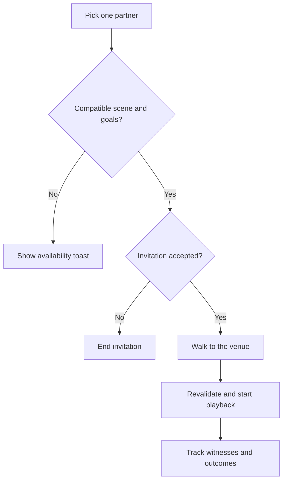

# HZoi Gameplay encounter design

**Status:** Proposed, iteration 1

HZoi Gameplay owns invitations, venue selection, witness reactions, and gameplay consequences. SceneZOI owns placement, playback, task progress, and cleanup. Installed content packs determine which pairs and venues can play a scene.

## Player interaction

Add **Have sex here** with a burning-heart icon to SceneZOI-supported beds and sofas and to walkable ground. Show it for a Young Adult or older initiator. Apply the same eligibility rule to picker candidates.

Keep eligibility in one easily configurable rule, because mods or updates may possibly add life stages. An unknown stage needs an explicit "is eligible" mapping. Ghosts are handled through separate native life-state interfaces, and supernatural Zois (likely coming from mods) such as a succubus, a vampire, an alien, may be implemented similarly. [Growth step enum](https://mod-docs.playinzoi.com/docs/modkit-docs/wiki/structguide/enum/eb1growthstep/) · [Life component](https://mod-docs.playinzoi.com/docs/modkit-docs/wiki/luaapi/b2/components/fb2lifecomponent/).

Open a picker patterned on SceneZOI’s debug starter. The initiator is fixed and the player selects one partner. Keep the roster representation compatible with more roles for later packs. The picker should return a selection without starting playback or causing the debug starter’s gameplay-group departures. [SceneZOI picker and group behavior](https://github.com/acepleiades/SceneZOI/blob/main/docs/group-support.md#solo-launcher-and-debug-picker).

### Content check and invitation

Resolve the actual roster, role bindings, and selected venue before the invitation. Require a compatible route to one `excitement` completion for each Zoi. The current content is expected to cover male/female pairs. Let male/male and female/female pairs reach the same check and show **No compatible scenes are available for these Zois at this spot** when no route exists. Content updates can enable those pairs without a gameplay rule change. Handle busy Zois, occupied furniture, and unreachable locations as temporary availability failures.

The initiator walks up and proposes the encounter using the **Set the Mood** conversation. Match the current build’s eligibility conditions, branch order, and acceptance/refusal weights from `Co_TryTo_Mood_Lover` and `Co_TryTo_Mood_Spouse`. Reuse the native social rules and approach dialogue. HZoi’s venue and adult-eligibility checks supply the equivalent context for ground and supported furniture. End the invitation on refusal. On acceptance, have both Zois walk to separate arrival points at the selected venue. Recheck eligibility, path arrival, and furniture availability before requesting playback. [Vanilla romance reference](inzoi-romance.md) · [Interaction branches](inzoi-romance-interactions.csv).

## Playback and consequences

Use `start_autonomous_scene` for both player- and NPC-initiated encounters. Request one `excitement` completion per participant, one stage, and `end_policy = {type = "goals"}`. Auto-mode already exits after both goals, authored completion responses, and any configured `post_completion_stay_seconds`. Manual takeover suspends planned exit. Keep the ordinary Exit control available. For furniture, pass `furniture_id` and the chosen `furniture_pair_id` for sofas. For ground, route the scene’s anchor-role Zoi to the clicked point. Current starts derive the ground anchor from a participant. Verify whether automatic placement adjustments stay within the chosen venue before deciding whether an explicit world anchor is needed. [SceneZOI start and plan API](https://github.com/acepleiades/SceneZOI/blob/main/docs/addons.md#autonomous-scenes).

Correlate `session_started` with the original request. Read per-Zoi `plan.goals` and `result_facts.task_state` on `session_ended`, with `get_session_result` for a missed event. Apply final moodlets once after cleanup. Process needs and urge fulfillment during playback. Keep the stop reason alongside the completion counts. A missing result leaves any unobserved outcome unknown. [SceneZOI outcomes](https://github.com/acepleiades/SceneZOI/blob/main/docs/addon-controls.md#observation-and-outcomes).

Action-specific urges, contraception, and pregnancy effects stay out of iteration 1.

### Needs on each Excitement completion

The live v0.11.2 bed sequence gives each Zoi the three costs through `Delay_30_MakeLove → MakeLove_AddStat` and the two gains through `Co_TryTo_Mood → Mood_Success`. The separate, conditional `Co_Mood_After` follow-up adds 10 Fun and 10 `Admit` to both Zois. Use the main interaction's five deltas for this milestone.

| Need | Native delta per Zoi | HZoi delta per completion |
| --- | ---: | ---: |
| Hunger (`Hunger`) | −50 | −12.5 |
| Hygiene (`Cleanliness`) | −50 | −12.5 |
| Energy (`Energy`) | −50 | −12.5 |
| Fun (`Fun`) | +10 | +5 |
| Social (`Society`) | +10 | +5 |

Apply the deltas during playback to the Zoi who completed the task. Each completion is independent of the other Zoi's result and of the eventual stop reason. Deduplicate using session ID, participant ID, task ID, and completion index. For a cost, apply at most the amount available above 33% of the configured need range. On the current −100 to +100 scale that floor is −34. A protected need already at or below 33% stays at its current value when HZoi applies the costs. Gains cap at the need maximum. Read the current value at each completion and verify the write path preserves the clamp even with native modifiers. Let natural decay continue throughout the scene, including below 33%. [SceneZOI completion events](https://github.com/acepleiades/SceneZOI/blob/main/docs/scene-tasks.md#completion-and-subscriptions) · [Native stat interface](https://mod-docs.playinzoi.com/docs/modkit-docs/wiki/luaapi/b2/components/fb2statcomponent/) · [AddStat rules](https://mod-docs.playinzoi.com/docs/modkit-docs/wiki/script-execution/exec-addstat/).

## Urges and NPC initiative

The game stores Urges as `Hope` rows with owner and target conditions, a lifetime, a cooldown group, and a mission. The closest match in the live build is `Trait_Needy_LoveLover`. It selects for an awake Emotionally Needy Zoi with a named lover, outside a rabbit hole, prison, site event, and the desert island. Its target must pass romantic eligibility and be a named lover at Romance below 30. The native row has a 12-hour lifetime and the `HopeCool_2Day` group. Its target-bound mission counts one `Event_MakingLove` talk. Carry those conditions over as the initial HZoi urge rules and apply the Youth-or-older policy to both Zois. For an NPC's invitation, also require the ordinary **Set the Mood** invitation rules and a feasible private venue. The urge makes a valid invitation more likely and can remain pending while a venue is unavailable. [Krafton's Urge selection notes](https://playinzoi.com/en/news/9309) · [Hope component](https://mod-docs.playinzoi.com/docs/modkit-docs/wiki/luaapi/b2/components/fb2hopecomponent/).

Store the urge owner, selected partner, and expiry. Subscribe to `task_completed`. Satisfy the active urge during the scene when the **owner** completes `excitement` and the **selected partner** is in that scene. Either Zoi can initiate. Acceptance, walking to the venue, or a completion by only the partner leaves the urge active. A later interruption leaves an earned completion intact.

Prototype a custom `Hope` and target-bound mission completed by a SceneZOI event. Probe `RequestAddSpecificAvailableHopeSingle` for selection, then inspect `GetSelectedHopes`, the slot's `ReasonTargetEntityId`, and the mission's `TargetEntityId` before testing the `OnFinishMission` handoff with the real mission ID. Verify the native UI updates, rewards are granted once, and the cooldown applies. If the native completion hook cannot service the custom mission, keep the partner-specific state and fulfillment in HZoi. [Hope component](https://mod-docs.playinzoi.com/docs/modkit-docs/wiki/luaapi/b2/components/fb2hopecomponent/) · [Native mission state](https://mod-docs.playinzoi.com/docs/modkit-docs/wiki/luaapi/b1/structs/fb1missionstate/).

## NPC privacy and venue selection

For autonomous invitations, search reachable private rooms on a residential site, preferring rooms meant for privacy such as bedrooms. Require vacancy except for the two participants. Public rooms, common circulation, and unclassified space are outside the NPC search. Player-directed venue choice keeps its existing rules.

1. First rank vacant rooms with a free supported bed or sofa and a compatible scene route for this pair. A sofa needs a free compatible seat pair. Prefer the nearest reachable room among valid candidates in this tier.
2. If none qualify, search vacant private rooms without supported furniture for a walkable ground anchor and a compatible standing route. Skip the attempt if neither tier has a valid candidate.

Use `find_furniture` for compatibility and furniture occupancy. Use `FB2Site:IsSameRoom` with the venue point and loaded Zois' positions for room occupancy, plus floor and residential-site checks. A read-only `build.scan_floors` call on the live apartment returned room geometry. Room purposes, interior boundaries, and path/access checks still need a runtime probe. A free bed alone establishes furniture availability. [Site API](https://mod-docs.playinzoi.com/docs/modkit-docs/wiki/luaapi/b2/structs/fb2site/) · [Room scan](https://mod-docs.playinzoi.com/docs/modkit-docs/wiki/cli/build/build-scan-floors/).

Watch the reserved room while the NPC pair walks there and check again immediately before start. If another Zoi enters before playback, cancel the attempt and release the venue. Have the NPC initiator show a localized overhead complaint chosen from a random pool, such as “Can’t we have a little private time?”, “They walked in at the worst moment,” or “I thought this room was empty.” A second line from the partner is optional and can use the same pool. Existing `SpeechBubble` rows and `AddSpeechBubble` support this presentation. Room intrusion before playback leaves the urge pending. Keep concurrent attempts independent and recheck participant and seat availability at arrival. [Native speech bubbles](https://mod-docs.playinzoi.com/docs/modkit-docs/wiki/script-execution/exec-addspeechbubble/).

**Vanilla comparison.** The reported **Suggest Having a Baby** attempt worked after the player cleared the bedroom and invited Seoyun in the living, dining, and kitchen area. The inspected `CanPregnancy_NoSpouse` condition has a double-bed presence check. The sequence then finds a bed through `AutoFind_Double_Bed` and `Sleep_Bed`. The inspected rows expose no room-vacancy predicate, so the toast's cause remains unresolved, maybe the NPCs in the room had been occupying the path. A controlled retry should change room occupancy alone, verify the same bed and slots are available, and capture the exact toast and failed sequence step. Empty rooms are HZoi's NPC venue policy.

## Witnesses and cheating

Check loaded Zois outside the roster during a currently playing intimate action, including Zois who arrive late. Use the directed action and participant IDs from `Client.actions(snapshot)`. Require an actual sight trace from the witness's viewpoint to the encounter. Use proximity only to bound candidate searches. A blocked or unavailable trace leaves the encounter unwitnessed. Verify the native trace against walls and closed doors across both camera and simulation states. [SceneZOI witness example](https://github.com/acepleiades/SceneZOI/blob/main/docs/addon-authoring.md#a-romantic-partner-catches-the-encounter) · [Native trace API](https://mod-docs.playinzoi.com/docs/modkit-docs/wiki/luaapi/b1/classes/ub1functionlibrary/).

An ordinary NPC witness reacts with surprise and prefers to walk away. After a verified sighting during playback, evaluate each session participant's preference once. HZoi requests ordinary exit only if **more than half of the full roster** prefers to stop. One of two is a tie and playback continues. Two of three stop the scene. The normal player Exit remains available.

For an ordinary sighting, a participant defaults to continuing unless a trait gives them a stop preference. For an official-partner sighting, each participant defaults to stopping. A **Rulebreaker with the Flirt characteristic** prefers to continue even when their own official partner is the witness. This applies only to that Zoi's preference. For example, with one Rulebreaker + Flirt and one participant who prefers to stop, the two-Zoi scene continues and the cheating incident is still recorded.

Record a confirmed official-partner incident as soon as the witness sees the encounter. Use `Youth_Lover`, engagement, or spouse. Capture the witness, their involved partner, the other participant, and the session ID. Deduplicate by session, witness, and involved partner. The stop preference decides playback. The verified sighting decides cheating.

After ordinary exit and cleanup, deliver the same confirmed-affair reaction that **Set the Mood** uses. Call `OnReceiveHowling("Howling_Affair_Confirmed", involvedPartnerId)` on the witness's Howling component with the recorded roles. Queue this same handoff when a scene continues and deliver it when that scene ends. Preserve native trait reactions, records, flags, and score consequences. Validate the third-participant handoff before relying on native three-Zoi confrontation. If the directed call fails after a verified sighting and correct role handoff, retain the HZoi incident, log delivery and cooldown details, and investigate a possible inZOI defect. [Vanilla test findings](inzoi-romance.md#conclusions-from-the-tests) · [Native Howling API](https://mod-docs.playinzoi.com/docs/modkit-docs/wiki/luaapi/b2/components/fb2howlingcomponent/).

## Outcome moodlets and personality

The live game already varies reactions by outcome and personality. `Buff_Mood_Success_01` is `Enchanting` +5 for 90 game minutes. `Buff_Mood_Success_02` is `Calm` +2 for 60. The two failure variants use `Irritated` or `Sad` +2 for 60. The meditation script gives Authoritarian (`Arrogant`) `Irritated` +2 for 180, while Pacifist (`Peacemaker`) and Idealist (`Dreamer`) receive Calm. The confirmed-affair script has its own trait reactions and a caught buff of `Cringing` +6 for 300. Its gloating witness variant uses `Excited` +7 and belongs to the native Flirt characteristic. HZoi can use the same pattern of localized titles, causes, durations, and trait overrides. [Buff metadata](https://mod-docs.playinzoi.com/docs/modkit-docs/wiki/luaapi/b1/structs/fb1buffbasicinfo/) · [Buff API](https://mod-docs.playinzoi.com/docs/modkit-docs/wiki/luaapi/b2/components/fb2buffcomponent/).

| Per-Zoi result | Proposed default |
| --- | --- |
| Both complete | **In Sync**, positive for each Zoi. |
| Only this Zoi completes | **Satisfied**, a milder positive moodlet. |
| Only the other Zoi completes | **Out of Sync**, a mild disappointment. A trait can replace it with a different response. |
| Neither completes and an ordinary sighting stops the scene | **Awkward Timing**, Flustered or Annoyed according to trait. |
| Neither completes and a participant ends it | **Unfinished Moment**, a mild letdown. |
| Neither completes and playback times out | Technical failure. Clean up the scene and log the timeout. The timeout itself adds no moodlet, relationship, need, or urge effect. Earlier verified events still count. |
| Official partner catches the encounter | Native cheating moodlets and consequences. A trait can contribute an HZoi reaction while preserving the native result. |
| Room becomes occupied en route, assets fail, or the game interrupts for saving or teardown | Use the privacy complaint or technical feedback as appropriate. Earned completions remain eligible for their moodlets. |

Keep a completion result and a stop reason separately. A Zoi can earn satisfaction before an interruption and still react to being seen. Apply at most one HZoi outcome moodlet and one distinct witness moodlet per Zoi. When several traits match, use the most specific rule and break ties with the core personality. Iteration 1 uses current outcomes, current witness type, moodlet adjustments, speech bubbles, and stop preferences. The trait rules need no venue history, follow-up activities, or schedule changes.

### All core traits

The live `Trait` table has 18 `Nature` rows. The reactions below are HZoi proposals. Mood names use the in-game labels. [Krafton's trait ID reference](https://playinzoi.com/en/guide/cheats#trait--characteristic-id).

| Trait | Trigger | Iteration 1 reaction |
| --- | --- | --- |
| Perfectionist (`Perfectionist`) | Only one completes, or the encounter is seen | **Out of Order** adds Annoyed on a mismatch. When seen, prefers to stop and says “Could you knock next time?” |
| Innovator (`Activist`) | Both complete | **Found a Better Rhythm** adds 5 Curiosity points (`Curious`), enough for Inspired in that mood family. Reason text “Exploring new boundaries with someone special felt exciting.” |
| Recluse (`Helper`) | Encounter is seen | **Nowhere to Hide** adds Flustered (`Cringing`). Prefers to stop and says “I wanted a moment to ourselves.” |
| Charmer (`Romantic`) | Earns a positive completion moodlet | Add one point to that moodlet's usual strength. |
| Socialite (`Popular`) | Ordinary witness | **Played It Cool** adds Content. |
| Go-Getter (`Achiever`) | Neither completes before a participant ends the scene | **Unfinished Business** adds Annoyed. |
| Visionary (`Artist`) | Both complete | **Perfect Improvisation** adds Curious. |
| Individualist (`Independent`) | Only the other Zoi completes | **At My Own Pace** adds Content. |
| Explorer (`Observer`) | Only one completes | **Something to Think About** adds Curious. |
| Intellectual (`Intellect`) | Only one completes | **A Question of Timing** adds Focused. |
| Sentinel (`Risk-averse`) | Encounter is seen | **Exactly What I Worried About** adds Nervous. Prefers to stop. |
| Rulebreaker (`Cooperator`) | Their official partner sees the encounter | **Thrill of Being Caught** adds Excited alongside the native reaction. With Flirt, prefers to continue. |
| Troublemaker (`Entertainer`) | Ordinary witness | **What an Entrance** adds Amused. |
| Adventurer (`Adventurer`) | Both complete | **Worth the Rush** adds Excited. |
| Authoritarian (`Arrogant`) | Encounter is seen | **Who Let Them In?** adds Annoyed. Prefers to stop. |
| Leader (`Leader`) | An ordinary sighting stops the scene | **Kept It Together** adds Confident. |
| Pacifist (`Peacemaker`) | Only the other Zoi completes | **I’m Glad You Enjoyed It** adds Content. Prefers to stop when seen. |
| Idealist (`Dreamer`) | Both complete | **The World Went Quiet** adds Content. |

### Characteristics and aptitudes

Each row proposes a moodlet or a stop preference using the same outcome data. The four toddler-only rows `Baby_Troublemaker`, `Baby_Innocent`, `Baby_Cuty`, and `Baby_Feisty` stay outside encounter eligibility.

| Characteristic | Iteration 1 reaction |
| --- | --- |
| Extroverted (`Extrovert`) | **Let’s Laugh About It** adds Amused after an ordinary sighting. |
| Introverted (`Introvert`) | **Too Many Eyes** adds Flustered when seen. Prefers to stop. |
| Cheerful (`Cheerful`) | **Still a Good Time** adds Content when only the other Zoi completes. |
| Depressed (`Gloomy`) | **A Little Light** adds Content when both complete. |
| Clumsy (`Clumsy`) | **That Was Awkward** adds Flustered when an ordinary sighting stops the scene. |
| Bookworm (`Bookworm`) | **A Chapter Worth Keeping** adds Moved when both complete. |
| Emotionally Needy (`Needy`) | **Stay Close** adds Sad when only the other Zoi completes. |
| Fitness Enthusiast (`Active`) | **Found Our Pace** adds Excited when both complete. |
| Lively (`Energetic`) | **Still Buzzing** adds Excited when only this Zoi completes. |
| Neat Freak (`CleanFreak`) | **Could Use a Shower** adds Uncomfortable if Hygiene is low at exit after an earned completion. |
| Childish (`Childish`, adult Zoi) | **Couldn’t Keep a Straight Face** adds Amused after an ordinary sighting. |
| Genius (`Genius`) | **We Can Work That Out** adds Focused when only the other Zoi completes. |
| Slacker (`Lazy`) | **Good Enough for Me** adds Content when only this Zoi completes. |
| Materialistic (`Snob`) | **A Little Luxury** adds Content when both complete in a furniture scene. |
| Malicious (`Mean`) | **I Got Mine** adds Amused when only this Zoi completes. |
| Workaholic (`Workaholic`) | **A Break Well Spent** adds Content when both complete. |
| Flirt (`Flirt`) | **Cool Under Pressure** adds Amused after an ordinary sighting. With Rulebreaker, prefers to continue when their official partner sees the encounter. |
| Devoted (`Faithful`) | **What Have I Done?** adds Sad when caught by their official partner. Prefers to stop. |

| Aptitude ID | Iteration 1 reaction |
| --- | --- |
| `Aptitude_Peace` | **Quiet Again** adds Content when an ordinary sighting stops the scene. |
| `Aptitude_Wikipedia` | **Well, Now I Know** adds Curious when only one completes. |
| `Aptitude_Seeker` | **Worth the Detour** adds Excited when both complete. |
| `Aptitude_Casanova` | **A Good Impression** adds Aflutter when both complete. |
| `Aptitude_CoffeeMaster` | **A Pleasant Buzz** adds Excited when only this Zoi completes. |
| `Aptitude_BakingMaster` | **Sweet Finish** adds Content when both complete. |
| `Aptitude_BeverageMaster` | **Taking It Easy** adds Content when an ordinary sighting stops the scene. |
| `Aptitude_Collect` | **A Memory to Keep** adds Moved when both complete. |
| `Aptitude_Fishing` | **Better Luck Next Time** adds Content if a participant ends the scene and neither completed. |
| `Aptitude_Smith` | **Found the Fit** adds Focused when both complete in a furniture scene. |
| `Aptitude_Swim` | **A Second Wind** adds Excited on their own completion. |
| `Aptitude_FirstImpression` | **Kept My Composure** adds Confident after an ordinary sighting. |

## First API probes

| Area | Probe and expected result |
| --- | --- |
| Content preflight | Negotiate `get_version`. Use `find_scenes`, `find_furniture`, and `validate_start` with `start_mode = "start_autonomous_scene"` and the real goal payload. Test a supported pair, an unsupported pair, and a compatible scene with an unreachable goal. Current preflight checks distance and returns `assets_checked = false`. Its response omits the route uncertainty reported by start. If this blocks the pre-invitation guarantee, expose a catalog-only goal-route check with route certainty and keep live placement checks at arrival. |
| Menu, dialogue, and walking | Check object and ground interaction hooks separately. Prototype the native picker look using the debug starter’s `UB1ZoiGroupEditUIHandler` approach. Test a custom `InteractionBag` and `Coop` for the approach and refusal, then verify native walking completes for both Zois before scene setup. [Coop action](https://mod-docs.playinzoi.com/docs/modkit-docs/wiki/luaapi/b2/actions/fb2action-coop/) · [WalkTo action](https://mod-docs.playinzoi.com/docs/modkit-docs/wiki/luaapi/b2/actions/fb2action-walkto/). |
| Results and moodlets | Verify two, one, and zero completions, plus player Exit, catching, and a timeout with zero completions. The timeout should only clean up and log. Test Auto-mode and the optional stay. Verify the trait moodlet, reason text, and speech bubbles. |
| Urges | Compare the selected partner, a different partner, partner-only completion, and matching owner completion. Test native UI, completion reward, cooldown, and idempotency. |
| Needs | Test each need below, at, and just above 33%, plus near-full Fun and Social. Verify quarter deltas for each completion, native decay while playing, and duplicate-event handling. |
| Witness roles and stop preferences | Test an open doorway, a closed door at the same distance, a visible unrelated NPC, and an official partner arriving off-camera. Check 1 of 2, 2 of 2, and a simulated 2 of 3 stop preferences. Verify that the Rulebreaker + Flirt case continues at a tie and delivers the recorded official-partner reaction once after exit. |
| NPC venues and concurrency | Test a private room with compatible free furniture, an empty furniture-free room with a compatible standing route, and a public-room rejection. Have a third Zoi enter while the pair walks to the venue. Verify the complaint, canceled start, and pending urge. Check that independent pairs can play simultaneously and competing sofa attempts preserve the active scene. |
