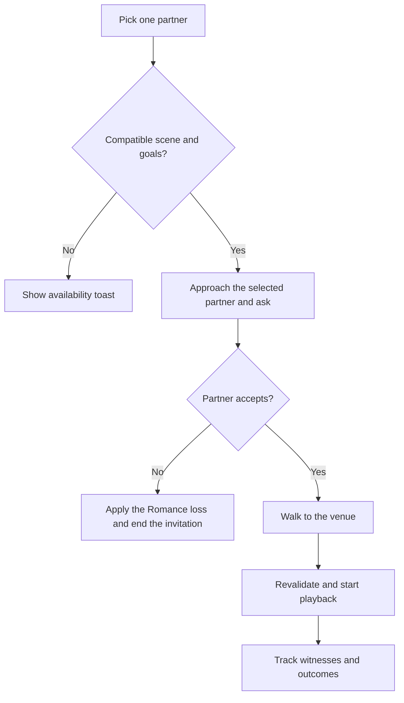

# HZoi Gameplay encounter design

**Status:** Proposed, iteration 1

Iteration 1 supports encounters between exactly two Zois. HZoi Gameplay owns invitations, venue selection, witness reactions, and gameplay consequences. SceneZOI owns placement, playback, task progress, and cleanup. Installed content packs determine which pairs and venues can play a scene. Iteration 1 is complete when every item and acceptance check below passes for that two-Zoi scope.

## Player interaction

Add **Have sex here** with a burning-heart icon to SceneZOI-supported beds and sofas and to walkable ground. Show it for a Young Adult or older initiator. Apply the same eligibility rule to picker candidates.

Keep eligibility in one easily configurable rule, because mods or updates may possibly add life stages. An unknown stage needs an explicit "is eligible" mapping. Ghosts are handled through separate native life-state interfaces, and supernatural Zois (likely coming from mods) such as a succubus, a vampire, an alien, may be implemented similarly. [Growth step enum](https://mod-docs.playinzoi.com/docs/modkit-docs/wiki/structguide/enum/eb1growthstep/) · [Life component](https://mod-docs.playinzoi.com/docs/modkit-docs/wiki/luaapi/b2/components/fb2lifecomponent/).

Open the same native picker as SceneZOI’s debug starter. The selected pair must include the controlled Zoi and one partner. The picker returns the partner to HZoi Gameplay so it can run the invitation. Existing gameplay groups stay intact. Keep the roster representation compatible with more roles for later packs. [SceneZOI picker and group behavior](https://github.com/acepleiades/SceneZOI/blob/main/docs/group-support.md#solo-launcher-and-debug-picker).

### Content check and invitation

Resolve the actual roster, role bindings, and selected venue before the invitation. Require a compatible route to one `excitement` completion for each Zoi. The current content is expected to cover male/female pairs. Let male/male and female/female pairs reach the same check and show **No compatible scenes are available for these Zois at this spot** when no route exists. Content updates can enable those pairs without a gameplay rule change. Handle busy Zois, occupied furniture, and unreachable locations as temporary availability failures.

The picker chooses whom to ask. The initiator then walks up to the selected partner and asks through an interaction modeled on inZOI’s **Set the Mood Next to Bed**. Use the native approach dialogue and match the social eligibility, branch order, and acceptance/refusal weights from `Co_TryTo_Mood_Lover` and `Co_TryTo_Mood_Spouse`. HZoi’s venue and adult-eligibility checks supply the equivalent context for ground and supported furniture. [Vanilla romance reference](inzoi-romance.md) · [Interaction branches](inzoi-romance-interactions.csv).

- **If the partner accepts**, have both Zois walk to separate arrival points at the selected venue. Recheck eligibility, arrival, and furniture availability before requesting SceneZOI playback. Acceptance alone gives no Romance bonus.
- **If the partner refuses**, play the refusal branch, apply the [Romance loss](#romance-changes) when the refusal happens, and end the invitation there. For two Zois who can otherwise use the interaction and have no established romantic relationship, a Romance score below 30 always takes this branch.

### Group invitations

How acceptance and refusal work for encounters with three or more Zois is undecided. Three or more participants are outside iteration 1. Define that flow when the picker supports selecting more than one partner.

## Playback and consequences

Use the same `start_autonomous_scene` request for player and NPC encounters. Initial sexual activity uses approved non-penetrative and non-coital penetrative actions from SceneZOI's `sexual_activity` metadata. Stages 1–2 prioritize those clips and can start with intercourse if that provides a better goal route. Stages 3–4 prioritize vaginal intercourse and permit anal intercourse for a male/male pair. SceneZOI prefers variety among reachable clips in the same priority tier and verifies that both goals can be completed along one route. [Request and automatic action policy](autonomous-scene-start.md).

The leading participant's Excitement progress makes stages 2–4 due at 25%, 50%, and 75%. Each stage selects its playback speed from 0.5×, 1×, 1.5×, and 2×. The scene and the user's task settings govern Excitement gain. A Zoi can complete again while the other catches up. When both goals are complete, Auto waits six seconds at Normal simulation speed and allows any active completion effects to settle. Exit restores both Zois to their arrival transforms. [SceneZOI start and plan API](https://github.com/acepleiades/SceneZOI/blob/main/docs/addons.md#autonomous-scenes).

The player can select a controllable participant, turn off Auto, and navigate the compatible authored scenes. While in manual control, reaching both goals keeps playback running. Manual Exit determines the outcome from the recorded completions. Re-enabling Auto after completing both goals during manual control exits as soon as active completion effects settle.

Correlate `session_started` with the original request. Read per-Zoi `plan.goals` and `result_facts.task_state` on `session_ended`, with `get_session_result` for a missed event. Apply the final Romance bonus and outcome moodlets once after confirmed cleanup. Process needs and urge fulfillment during playback. Keep the stop reason alongside the completion counts. A missing result leaves any unobserved outcome unknown. [SceneZOI outcomes](https://github.com/acepleiades/SceneZOI/blob/main/docs/addon-controls.md#observation-and-outcomes).

Action-specific urges, contraception, and pregnancy effects stay out of iteration 1.

### Romance changes

Use inZOI’s **Set the Mood Next to Bed** as the reference for the refusal penalty and full success bonus. Follow the native [Romance effects](inzoi-romance.md#set-the-mood-romance-effects) for the amount, affected relationship directions, and any differences between lover and spouse branches. Confirm those values in a clean native interaction before implementing the writes. Use a smaller positive amount for partial success.

| What happened | Romance change |
| --- | --- |
| The partner refuses | Apply the native-style loss once as soon as the conversation confirms the refusal. |
| The partner accepts | Wait for the actual outcome. |
| The scene fails to start, or the invitation is canceled or unavailable | No change. |
| Playback ends normally or through a normal Exit, and neither Zoi completes their goal | No bonus. |
| Playback ends normally or through a normal Exit, and one Zoi completes their goal | Apply the small bonus after cleanup. |
| Playback ends normally or through a normal Exit, and both Zois complete their goals | Apply the full bonus after cleanup. |
| A technical failure, game lifecycle event, or unknown result ends the scene | No final Romance bonus. Verified needs, Urge fulfillment, and witness incidents still count. |

Count how many distinct participants completed their goal. Two completions by the same Zoi still count as partial success. Apply at most one Romance outcome per invitation. Use the verified end result for manual Exit and a normal Exit requested by a witness reaction, too. Check the reused native dialogue and our own writes together so refusal applies exactly once and acceptance never grants early Romance. Any separate cheating effect still follows the native witness rules.

### Needs on each Excitement completion

The live v0.11.2 bed sequence gives each Zoi the three costs through `Delay_30_MakeLove → MakeLove_AddStat` and the two gains through `Co_TryTo_Mood → Mood_Success`. The separate, conditional `Co_Mood_After` follow-up adds 10 Fun and 10 `Admit` to both Zois. Use the main interaction's five deltas for this milestone.

| Need | Native delta per Zoi | HZoi delta per completion |
| --- | ---: | ---: |
| Hunger (`Hunger`) | −50 | −12.5 |
| Hygiene (`Cleanliness`) | −50 | −12.5 |
| Energy (`Energy`) | −50 | −12.5 |
| Fun (`Fun`) | +10 | +5 |
| Social (`Society`) | +10 | +5 |

Apply the deltas during playback to the Zoi who completed the task. Each completion is independent of the other Zoi's result and of the eventual stop reason. Deduplicate using session ID, participant ID, task ID, and completion index. For a cost, apply at most the amount available above 33% of the configured need range. On the current −100 to +100 scale that floor is −34. A protected need already at or below 33% stays at its current value when HZoi applies the costs. Gains cap at the need maximum. Read the current value at each completion and verify the write path preserves the clamp even with native modifiers. Let natural decay continue throughout the scene, including below 33%. [SceneZOI completion events](https://github.com/acepleiades/SceneZOI/blob/main/docs/scene-tasks.md#completion-and-subscriptions) · [Native stat interface](https://mod-docs.playinzoi.com/docs/modkit-docs/wiki/luaapi/b2/components/fb2statcomponent/) · [AddStat rules](https://mod-docs.playinzoi.com/docs/modkit-docs/wiki/script-execution/exec-addstat/).

## Urges and NPC initiative

An NPC can autonomously choose **Have sex here** only if the initiator's effective native **Romance** autonomy category is enabled and ordinary autonomy checks pass. Respect any inherited setting and per-Zoi override. Read the setting when choosing an initiator and recheck before dispatching the invitation or starting playback. If Romance is turned off while the autonomous attempt is pending, cancel it, release the venue, and leave any Urge pending. An encounter already playing can finish. The category governs autonomous initiation. A player-directed invitation can still use the usual native rules. Identify and test the exact native setting using the in-game toggle before enabling the scheduler gate.

The game stores Urges as `Hope` rows with owner and target conditions, a lifetime, a cooldown group, and a mission. The closest match in the live build is `Trait_Needy_LoveLover`. It selects for an awake Emotionally Needy Zoi with a named lover, outside a rabbit hole, prison, site event, and the desert island. Its target must pass romantic eligibility and be a named lover at Romance below 30. The native row has a 12-hour lifetime and the `HopeCool_2Day` group. Its target-bound mission counts one `Event_MakingLove` talk. Carry those conditions over as the initial HZoi urge rules and apply the Youth-or-older policy to both Zois. For an NPC's invitation, also require the ordinary **Set the Mood** invitation rules and a feasible private venue. The urge makes a valid invitation more likely and can remain pending while a venue is unavailable. [Krafton's Urge selection notes](https://playinzoi.com/en/news/9309) · [Hope component](https://mod-docs.playinzoi.com/docs/modkit-docs/wiki/luaapi/b2/components/fb2hopecomponent/).

Store the urge owner, selected partner, and expiry. Subscribe to `task_completed`. Satisfy the active urge during the scene when the **owner** completes `excitement` and the **selected partner** is in that scene. Either Zoi can initiate. Acceptance, walking to the venue, or a completion by only the partner leaves the urge active. A later interruption leaves an earned completion intact.

The native `Hope` test loaded the custom row, but forced selection left its
partner and mission target IDs unset. Iteration 1 uses
[HZoi-owned Urges](../prototype/queen-bed/owned-urges.md) with the original
reward. The offer and cooldown are scoped to the current loaded world.

## NPC privacy and venue selection

For autonomous invitations, search reachable private rooms on a residential site, preferring rooms meant for privacy such as bedrooms. Require vacancy except for the two participants. Public rooms, common circulation, and unclassified space are outside the NPC search. Player-directed venue choice keeps its existing rules.

1. First rank vacant rooms with a free supported bed or sofa and a compatible scene route for this pair. A sofa needs a free compatible seat pair. Prefer the nearest reachable room among valid candidates in this tier.
2. If none qualify, search vacant private rooms without supported furniture for a walkable ground anchor and a compatible standing route. Skip the attempt if neither tier has a valid candidate.

Use `find_furniture` for compatibility and furniture occupancy. Use `FB2Site:IsSameRoom` with the venue point and loaded Zois' positions for room occupancy, plus floor and residential-site checks. A read-only `build.scan_floors` call on the live apartment returned room geometry. Live tests confirmed a private-room mark, cancellation when another Zoi entered, and the standing fallback after the bed was removed. Verify room classification, door permissions, floor boundaries, and route access across the venues we support. A free bed only establishes furniture availability. [Site API](https://mod-docs.playinzoi.com/docs/modkit-docs/wiki/luaapi/b2/structs/fb2site/) · [Room scan](https://mod-docs.playinzoi.com/docs/modkit-docs/wiki/cli/build/build-scan-floors/).

Watch the reserved room while the NPC pair walks there and check again immediately before start. If another Zoi enters before playback, cancel the attempt and release the venue. Have the NPC initiator show a localized overhead complaint chosen from a random pool, such as “Can’t we have a little private time?”, “They walked in at the worst moment,” or “I thought this room was empty.” A second line from the partner is optional and can use the same pool. Existing `SpeechBubble` rows and `AddSpeechBubble` support this presentation. Room intrusion before playback leaves the urge pending. Keep concurrent attempts independent and recheck participant and seat availability at arrival. [Native speech bubbles](https://mod-docs.playinzoi.com/docs/modkit-docs/wiki/script-execution/exec-addspeechbubble/).

**Vanilla comparison.** The reported **Suggest Having a Baby** attempt worked after the player cleared the bedroom and invited Seoyun in the living, dining, and kitchen area. The inspected `CanPregnancy_NoSpouse` condition has a double-bed presence check. The sequence then finds a bed through `AutoFind_Double_Bed` and `Sleep_Bed`. The inspected rows expose no room-vacancy predicate, so the toast's cause remains unresolved, maybe the NPCs in the room had been occupying the path. A controlled retry should change room occupancy alone, verify the same bed and slots are available, and capture the exact toast and failed sequence step. Empty rooms are HZoi's NPC venue policy.

## Witnesses and cheating

Check loaded Zois outside the roster during a currently playing intimate action, including Zois who arrive late. Use the directed action and participant IDs from `Client.actions(snapshot)`. Require an actual sight trace from the witness's viewpoint to the encounter. Use proximity only to bound candidate searches. A blocked or unavailable trace leaves the encounter unwitnessed. Verify the native trace against walls and closed doors across both camera and simulation states. [SceneZOI witness example](https://github.com/acepleiades/SceneZOI/blob/main/docs/addon-authoring.md#a-romantic-partner-catches-the-encounter) · [Native trace API](https://mod-docs.playinzoi.com/docs/modkit-docs/wiki/luaapi/b1/classes/ub1functionlibrary/).

An ordinary NPC witness reacts with surprise and prefers to walk away. After a verified sighting during playback, evaluate each session participant's preference once. HZoi requests ordinary exit only if **more than half of the full roster** prefers to stop. One of two is a tie and playback continues. In a future three-Zoi encounter, two would stop the scene. The normal player Exit remains available.

For an ordinary sighting, a participant defaults to continuing unless a trait gives them a stop preference. For an official-partner sighting, each participant defaults to stopping. The **Rulebreaker trait or the Flirt characteristic** is enough for a Zoi to prefer to continue, even if their own official partner is the witness. That preference takes priority for that Zoi. Two Rulebreakers, two Flirts, or one of each count as two participants who prefer to continue. Each Zoi counts once, including a Zoi with both. In a future group of three, two continuing participants would keep the scene going. The official-partner sighting still counts as cheating.

Record a confirmed official-partner incident as soon as the witness sees the encounter. Use `Youth_Lover`, engagement, or spouse. Capture the witness, their involved partner, the other participant, and the session ID. Deduplicate by session, witness, and involved partner. The stop preference decides playback. The verified sighting decides cheating.

After ordinary exit and cleanup, deliver the same confirmed-affair reaction that **Set the Mood** uses. Call `OnReceiveHowling("Howling_Affair_Confirmed", involvedPartnerId)` on the witness's Howling component with the recorded roles. Queue this same handoff when a scene continues and deliver it when that scene ends. Preserve native trait reactions, records, flags, and score consequences. Validate the third-participant handoff before relying on native three-Zoi confrontation. If the directed call fails after a verified sighting and correct role handoff, retain the HZoi incident, log delivery and cooldown details, and investigate a possible inZOI defect. [Vanilla test findings](inzoi-romance.md#conclusions-from-the-tests) · [Native Howling API](https://mod-docs.playinzoi.com/docs/modkit-docs/wiki/luaapi/b2/components/fb2howlingcomponent/).

## Outcome moodlets and personality

The encounter outcome determines each Zoi’s default moodlet. Their traits can change the mood or its strength. Each moodlet has a title, reason text, emotion, point value, and duration.

| Per-Zoi result | Proposed default | In-game tooltip |
| --- | --- | --- |
| Both complete | **In Sync**, Content for each Zoi. | [From finishing together] You and your partner found a rhythm that worked for both of you. |
| Only this Zoi completes | **Satisfied**, a milder Content moodlet. | [From being the only one to finish] You came away satisfied. |
| Only the other Zoi completes | **Out of Sync**, mild Sad. | [From only your partner finishing] You were left wanting more. |
| Neither completes and an ordinary sighting stops the scene | **Awkward Timing**, Flustered. | [From being seen] Someone saw you, and the encounter ended early. |
| Neither completes and a participant ends it | **Unfinished Moment**, mild Sad. | [From ending the encounter early] You were disappointed that the moment ended so soon. |
| Official partner catches the encounter | Native cheating moodlets and consequences. A trait can contribute an HZoi reaction. | — |
| Room becomes occupied en route | Expected privacy cancellation. Give the NPC initiator a privacy complaint, cancel the attempt, release the venue, and leave the urge pending. | — |
| SceneZOI fails to start or ends for a technical reason, including a mid-scene timeout | Use technical feedback and diagnostics and let SceneZOI run cleanup. The failure adds no moodlet, relationship, need, or urge effect. Verified completions and sightings still count. | — |
| Game lifecycle ends the scene, such as saving, opening Create a Zoi, or unloading the mod | End neutrally. Preserve any verified completions and sightings. Teardown may leave the final result unavailable. | — |

Keep a completion result and a stop reason separately. A Zoi can earn satisfaction before an interruption and still react to being seen. Apply at most one HZoi outcome moodlet and one distinct witness moodlet per Zoi. When several traits match, use the most specific rule and break ties with the core personality. Iteration 1 uses current outcomes, current witness type, moodlet adjustments, speech bubbles, and stop preferences. The trait rules need no venue history, follow-up activities, or schedule changes.

Evaluate a completion moodlet from the perspective of the Zoi receiving it. When only the other Zoi completes, trait variants can express sadness, frustration, or anxiety and can soften the intensity. Witness moodlets use the sighting and the Zoi's response to it.

### SceneZOI failure signals

| Stage | Examples from the checked SceneZOI code |
| --- | --- |
| Start or preparation | `session_start_failed` with `start_failed` for startup errors such as missing assets or a timed-out start bridge. After session allocation, participant preparation or binding can fail (`prepare_error`, `binding_error`) or a preparation barrier can time out (`prepare_timeout`, `appearance_timeout`, `attachment_timeout`, `outfit_timeout`). Some of these barriers also run during scene changes. [Start handling](https://github.com/acepleiades/SceneZOI/blob/6228dbd6d584c27cacce42dd0fc12b6ab6f018eb/modkit/SceneZOI_93C44199/workspace/lua/B1/SceneZOI/AddonAPI.lua#L68) · [Preparation barriers](https://github.com/acepleiades/SceneZOI/blob/6228dbd6d584c27cacce42dd0fc12b6ab6f018eb/modkit/SceneZOI_93C44199/workspace/lua/B1/SceneZOI/Runtime.lua#L1351). |
| Playback | A runtime update error (`runtime_error`), a failed transition destination (`transition_destination_error`), an unavailable goal route or stage (`goal_unreachable`, `required_stage_unavailable`), a stall or budget limit (`no_progress`, `playback_budget_exceeded`), a disconnected UI (`ui_disconnected`), a lost participant or changed furniture (`participant_unloaded`, `furniture_changed`), or an expired session or owner lease (`lifetime_expired`, `owner_expired`). [Planner stops](https://github.com/acepleiades/SceneZOI/blob/6228dbd6d584c27cacce42dd0fc12b6ab6f018eb/docs/addons.md#end-policies-and-safety-stops) · [Runtime stop checks](https://github.com/acepleiades/SceneZOI/blob/6228dbd6d584c27cacce42dd0fc12b6ab6f018eb/modkit/SceneZOI_93C44199/workspace/lua/B1/SceneZOI/Runtime.lua#L1333) · [Runtime error handler](https://github.com/acepleiades/SceneZOI/blob/6228dbd6d584c27cacce42dd0fc12b6ab6f018eb/modkit/SceneZOI_93C44199/workspace/lua/B1/SceneZOI/Runtime.lua#L1507). |
| Cleanup | `restore_error` or `restore_timeout` in `result_facts.cleanup_code`. Keep this separate from the original `result_facts.stop_reason` so a cleanup failure preserves the reason the scene ended. Wait for confirmed restoration before queuing native reactions on the participants. [Outcome fields](https://github.com/acepleiades/SceneZOI/blob/6228dbd6d584c27cacce42dd0fc12b6ab6f018eb/docs/addon-controls.md#observation-and-outcomes). |

Use `session_start_failed` or `session_ended` to settle the encounter. A recoverable `task_route_failed` notification can leave playback running. A missing terminal event or an unrecognized end reason leaves any unverified outcome unknown. [Task-route handling](https://github.com/acepleiades/SceneZOI/blob/6228dbd6d584c27cacce42dd0fc12b6ab6f018eb/modkit/SceneZOI_93C44199/workspace/lua/B1/SceneZOI/Runtime.lua#L859) · [SceneZOI events](https://github.com/acepleiades/SceneZOI/blob/6228dbd6d584c27cacce42dd0fc12b6ab6f018eb/docs/addons.md#events-and-ownership).

### All core traits

The live `Trait` table has 18 `Nature` rows. The reactions below are HZoi proposals. Mood names use the in-game labels. [Krafton's trait ID reference](https://playinzoi.com/en/guide/cheats#trait--characteristic-id).

| Trait | Trigger | Iteration 1 reaction | In-game tooltip |
| --- | --- | --- | --- |
| Perfectionist (`Perfectionist`) | Only one completes, or the encounter is seen | **Out of Order** adds Annoyed on a mismatch. When seen, prefers to stop and says “Could you knock next time?” | [From a mismatch] The encounter felt out of step when only one of you finished. |
| Innovator (`Activist`) | Both complete | **Found a Better Rhythm** adds +2 to `Curious`. | [From finishing together] Exploring new boundaries with someone special felt exciting. |
| Recluse (`Helper`) | Encounter is seen | **Nowhere to Hide** adds Flustered (`Cringing`). Prefers to stop and says “I wanted a moment to ourselves.” | [From being seen] You wanted privacy. Being seen left you flustered. |
| Charmer (`Romantic`) | Earns a positive completion moodlet | Add one point to that moodlet's usual strength. | — |
| Socialite (`Popular`) | Ordinary witness | **Played It Cool** adds Content. | [From being seen] You took the awkward moment in stride. |
| Go-Getter (`Achiever`) | Neither completes before a participant ends the scene | **Unfinished Business** adds Annoyed. | [From ending the encounter early] You were frustrated to stop before either of you finished. |
| Visionary (`Artist`) | Both complete | **Perfect Improvisation** adds Curious. | [From finishing together] The rhythm you found together left you curious about what else might work. |
| Individualist (`Independent`) | This Zoi completes, whether or not the other Zoi does | **At My Own Pace** adds Content. | [From finishing] You enjoyed the moment on your own terms. |
| Explorer (`Observer`) | This Zoi completes | **Something to Think About** adds Curious. | [From finishing] You’re curious about what made the encounter feel so good. |
| Intellectual (`Intellect`) | Only the other Zoi completes | **A Question of Timing** adds Nervous. | [From only your partner finishing] You keep replaying the moment, wondering where your timing went wrong. |
| Sentinel (`Risk-averse`) | Encounter is seen | **Exactly What I Worried About** adds Nervous. Prefers to stop. | [From being seen] Someone saw you, just as you feared. |
| Rulebreaker (`Cooperator`) | Encounter is seen | Prefers to continue. If their official partner is the witness, **Thrill of Being Caught** adds Excited alongside the native reaction. | [From getting caught cheating] You felt an unexpected rush when your partner caught you. |
| Troublemaker (`Entertainer`) | Ordinary witness | **What an Entrance** adds Amused. | [From being seen] The awkward timing amused you. |
| Adventurer (`Adventurer`) | Both complete | **Worth the Rush** adds Excited. | [From finishing together] You came away exhilarated. |
| Authoritarian (`Arrogant`) | Encounter is seen | **Who Let Them In?** adds Annoyed. Prefers to stop. | [From being seen] You’re annoyed that someone intruded on a private moment. |
| Leader (`Leader`) | An ordinary sighting stops the scene | **Kept It Together** adds Confident. | [From an encounter interrupted by a witness] You kept your composure when the encounter ended. |
| Pacifist (`Peacemaker`) | Only the other Zoi completes | **Mixed Feelings** adds mild Sad. Prefers to stop when seen. | [From only your partner finishing] You’re glad your partner enjoyed it. You wish you’d felt the same. |
| Idealist (`Dreamer`) | Both complete | **The World Went Quiet** adds Content. | [From finishing together] For a little while, it felt like you were the only two in the world. |

### Characteristics and aptitudes

Each row proposes a moodlet or a stop preference using the same outcome data. The four toddler-only rows `Baby_Troublemaker`, `Baby_Innocent`, `Baby_Cuty`, and `Baby_Feisty` stay outside encounter eligibility.

| Characteristic | Iteration 1 reaction | In-game tooltip |
| --- | --- | --- |
| Extroverted (`Extrovert`) | **Let’s Laugh About It** adds Amused after an ordinary sighting. | [From being seen] You found the funny side of being seen. |
| Introverted (`Introvert`) | **Too Many Eyes** adds Flustered when seen. Prefers to stop. | [From being seen] The extra attention made you feel exposed. |
| Cheerful (`Cheerful`) | **A Little Let Down** adds mild Sad when only the other Zoi completes. | [From only your partner finishing] You enjoyed being together and still feel a little let down. |
| Depressed (`Gloomy`) | **A Little Light** adds Content when both complete. | [From finishing together] Spending a good moment with someone brought you some relief. |
| Clumsy (`Clumsy`) | **That Was Awkward** adds Flustered when an ordinary sighting stops the scene. | [From an encounter interrupted by a witness] You were too flustered to know where to look. |
| Bookworm (`Bookworm`) | **A Chapter Worth Keeping** adds Moved when both complete. | [From finishing together] You shared a moment worth remembering. |
| Emotionally Needy (`Needy`) | **Stay Close** adds Sad when only the other Zoi completes. | [From only your partner finishing] You’re left wanting reassurance that your experience mattered too. |
| Fitness Enthusiast (`Active`) | **Found Our Pace** adds Excited when both complete. | [From finishing together] Finding a pace that suited you both gave you a rush. |
| Lively (`Energetic`) | **Still Buzzing** adds Excited when only this Zoi completes. | [From being the only one to finish] You’re still buzzing from how good it felt. |
| Neat Freak (`CleanFreak`) | **Could Use a Shower** adds Uncomfortable if Hygiene is low at exit after an earned completion. | [From low Hygiene after an encounter] You feel uncomfortable and keep thinking about getting clean. |
| Childish (`Childish`, adult Zoi) | **Couldn’t Keep a Straight Face** adds Amused after an ordinary sighting. | [From being seen] The surprise was enough to give you the giggles. |
| Genius (`Genius`) | **Missing Piece** adds Annoyed when only the other Zoi completes. | [From only your partner finishing] You’re frustrated that you can’t figure out why the encounter fell short for you. |
| Slacker (`Lazy`) | **Good Enough for Me** adds Content when only this Zoi completes. | [From being the only one to finish] You’re satisfied and ready to relax. |
| Materialistic (`Snob`) | **A Little Luxury** adds Content when both complete in a furniture scene. | [From finishing together] A comfortable place made the moment feel like a small luxury. |
| Malicious (`Mean`) | **I Got Mine** adds Amused when only this Zoi completes. | [From being the only one to finish] You feel smug about getting what you wanted. |
| Workaholic (`Workaholic`) | **A Break Well Spent** adds Content when both complete. | [From finishing together] Making time for each other felt worthwhile. |
| Flirt (`Flirt`) | Prefers to continue when seen, including by their own official partner. **Cool Under Pressure** adds Amused after an ordinary sighting. | [From being seen] The awkward moment amused you. |
| Devoted (`Faithful`) | **What Have I Done?** adds Sad when caught by their official partner. Prefers to stop. | [From getting caught cheating] You feel guilty for hurting your partner. |

| Aptitude ID | Iteration 1 reaction | In-game tooltip |
| --- | --- | --- |
| `Aptitude_Peace` | **Quiet Again** adds Content when an ordinary sighting stops the scene. | [From an encounter interrupted by a witness] The awkwardness passed once the encounter ended. |
| `Aptitude_Wikipedia` | **Well, Now I Know** adds Curious when only this Zoi completes. | [From being the only one to finish] You’re curious about what made the difference for you. |
| `Aptitude_Seeker` | **Worth the Detour** adds Excited when both complete. | [From finishing together] You’re glad you made time for a moment that felt this good. |
| `Aptitude_Casanova` | **A Good Impression** adds Aflutter when both complete. | [From finishing together] Knowing your partner enjoyed it too gave you butterflies. |
| `Aptitude_CoffeeMaster` | **A Pleasant Buzz** adds Excited when only this Zoi completes. | [From being the only one to finish] You still feel a little jolt of excitement. |
| `Aptitude_BakingMaster` | **Sweet Finish** adds Content when both complete. | [From finishing together] You’re still savoring how well the moment went. |
| `Aptitude_BeverageMaster` | **Taking It Easy** adds Content when an ordinary sighting stops the scene. | [From an encounter interrupted by a witness] You feel calmer now that the awkward moment has passed. |
| `Aptitude_Collect` | **A Memory to Keep** adds Moved when both complete. | [From finishing together] You shared a moment you want to remember. |
| `Aptitude_Fishing` | **Better Luck Next Time** adds mild Sad if a participant ends the scene and neither completed. | [From ending the encounter early] You’re disappointed it ended, and you hope next time goes better. |
| `Aptitude_Smith` | **Found the Fit** adds Focused when both complete in a furniture scene. | [From finishing together] Once you found a comfortable position, everything clicked. |
| `Aptitude_Swim` | **A Second Wind** adds Excited on their own completion. | [From finishing] You came away feeling energized. |
| `Aptitude_FirstImpression` | **Kept My Composure** adds Confident after an ordinary sighting. | [From being seen] Keeping your cool in an awkward moment made you feel more confident. |

## Implementation priority

The [iteration 1 test evidence](../prototype/queen-bed/README.md#iteration-1-test-evidence) records what the current build has demonstrated and which cases are covered by fixtures. Use this list for the full two-Zoi implementation, including requirements that need more work or live verification.

1. **Prove the native invitation on a queen bed.** Run acceptance and refusal through the native conversation and its eligibility, branch order, weights, and dialogue. On acceptance, take over before the native bed sequence, walk both Zois to separate arrival points, and prove SceneZOI can start and restore them. On refusal, end after the native refusal conversation and clear both action queues.
2. **Finish player entry and venue support.** Add the burning-heart **Have sex here** action, the native two-Zoi picker, and a shared, configurable life-stage mapping. Preserve existing groups. Check content compatibility and both goal routes before asking, including same-sex pairs and beds with and without optional AAL tracks. Support compatible bed types, adjacent sofa seats, and walkable ground. Give clear feedback for missing content, busy Zois, occupied spots, and unreachable venues. Recheck both arrivals, the venue, and the selected seats before playback, and keep spare sofa seats usable.
3. **Finish the four-stage playback plan.** Share the request between player and NPC encounters. Verify the opening and later activity priorities, excluded actions, variety, stage thresholds and speed presets, and both participants’ reachable goals. Preserve authored transitions, Auto’s six-second wait and completion effects, manual navigation and Exit, and the shorter path when Auto is re-enabled after both goals finish. Verify arrival transforms are restored.
4. **Track and settle each encounter.** Correlate the invitation, SceneZOI request, start, task completions, and terminal result. Recover missed results, track each completion once, and keep the original stop reason separate from cleanup errors. Handle cancellation, failed preparation, playback failure, lifecycle shutdown, unknown results, and concurrent encounters without losing verified completions or sightings.
5. **Add Romance consequences.** Measure the native refusal and success effects and check whether the reused dialogue already applies them. Apply the loss as soon as refusal is confirmed. Award the small or full bonus only after verified cleanup, based on one or both Zois completing. Check that zero completions, failed starts, and technical or unknown final results leave Romance alone.
6. **Finish Needs and outcome moodlets.** Apply each Zoi’s need changes per completion, including repeated completions, the 33% floor, and gain caps. Set strength and duration for the default moodlets and apply them after cleanup for the documented completion and stop outcomes.
7. **Finish witnesses, cheating, and personality reactions.** Verify line of sight, late arrivals, ordinary NPC surprise and walk-away when possible, and the stop vote. Record and deduplicate official-partner incidents. Verify the three roles, native reaction, and cooldown handling after cleanup even when a tie lets playback continue. Implement every core trait, characteristic, and aptitude rule, including localized participant dialogue, tie-breaking, and the Rulebreaker and Flirt overrides.
8. **Finish private NPC venue selection.** Verify residential room classification, vacancy, reachability, and permissions. Rank compatible free beds and sofa seats before ground fallback. Recheck on arrival. Cancel when someone enters en route, release the venue, and show a randomly selected localized privacy complaint. Test concurrent and competing claims.
9. **Finish partner-specific Urges and autonomous invitations.** Verify offer conditions, expiry, cooldown, partner matching, and one reward for the owner’s completion. Keep Urges pending during temporary unavailability. Verify the native Romance category, gate autonomous invitations on the initiator’s effective setting, and test a setting change during preparation. Verify ordinary autonomy and retry timing at Normal speed, including with the controlled household.
10. **Verify iteration 1 end to end.** Run the checks below on a fresh launch with the supported SceneZOI build and normal gameplay. Exercise both player-directed and autonomous encounters, with autonomy enabled where applicable. Cover each supported venue, both invitation answers, the consequence matrix, interruptions, and concurrent encounters. Confirm action queues, transforms, and venue reservations recover before calling the iteration complete.

## Acceptance checks

| Area | Probe and expected result |
| --- | --- |
| Content and venues | Check `get_version`, activity definitions, and the joint goal route. Test a supported pair, an intercourse-only opener, a pair with no compatible content, and a same-sex route if a test pack supplies one. Verify content-only preflight before walking and live placement validation afterward. Cover freestanding and wall-side beds, optional AAL, usable and occupied sofa pairs, a spare seat, and walkable and blocked ground. |
| Picker, dialogue, and walking | Check object and ground hooks separately. Confirm that the native picker preserves gameplay groups, uses the shared eligibility mapping, and returns the selected partner. Compare native acceptance and refusal, verify no walk after refusal, and wait for both to reach separate valid points on the correct floor before starting. [Coop action](https://mod-docs.playinzoi.com/docs/modkit-docs/wiki/luaapi/b2/actions/fb2action-coop/) · [WalkTo action](https://mod-docs.playinzoi.com/docs/modkit-docs/wiki/luaapi/b2/actions/fb2action-walkto/). |
| Adaptive playback | Verify all four stages, their thresholds and speeds, approved and excluded actions, and clip variety. Test direct routes and routes with authored transitions. Compare full Auto, manual Exit, and manual completion followed by re-enabling Auto. Verify the six-second Auto wait at Normal speed, settling of active completion effects, and restoration to arrival transforms. |
| Result recovery | Test zero, one, and two completed goals, repeated and duplicate completions, a missed callback recovered through `get_session_result`, and an unavailable result. Cover ordinary Exit, a failed start, a technical stop, lifecycle teardown, and incomplete cleanup. Verify separate stop and cleanup reasons and retention of earned needs, Urges, and verified sightings. |
| Romance outcomes | Measure the native relationship in both directions for each invitation branch, including caps and native modifiers. Check the refusal loss at the conversation and no early gain after acceptance. Verify zero, partial, and full bonus outcomes, a repeat completion by only one Zoi, a failed start, an interruption, and duplicate terminal notifications. |
| Needs and moodlets | Check all cost needs below, at, and just above 33%, plus near-full Fun and Social. Verify per-completion changes, natural decay, and deduplication. Test the outcome and witness moodlets separately, along with strength, duration, trait precedence, and localized dialogue. |
| Witnesses and cheating | Test an open doorway, a closed door at the same distance, a visible unrelated NPC who can walk away, and an established partner arriving off-camera. Check one and two stop votes, Rulebreaker and Flirt separately, and both traits on one Zoi. Verify an official-partner sighting at a tie grants the native reaction once after cleanup with the recorded roles. |
| NPC venues and concurrency | Test an accessible private room with a compatible free bed or sofa, the standing fallback when supported furniture is absent, and public, inaccessible, or occupied space. Have a third Zoi enter the chosen room during approach. Verify the localized complaint, released venue, and pending Urge. Check independent sessions and that a competing attempt leaves the active one intact. |
| Urges and Romance autonomy | Verify the HZoi-owned offer, matching partner, owner-only completion, expiry, cooldown, and a single reward. At Normal speed test global autonomy on with Romance off for the initiator, inherited settings, per-Zoi overrides, and toggling Romance off during preparation. Confirm the suppressed invitation leaves the Urge and Romance score alone, an already-playing scene can finish, and manual **Have sex here** still works. |
