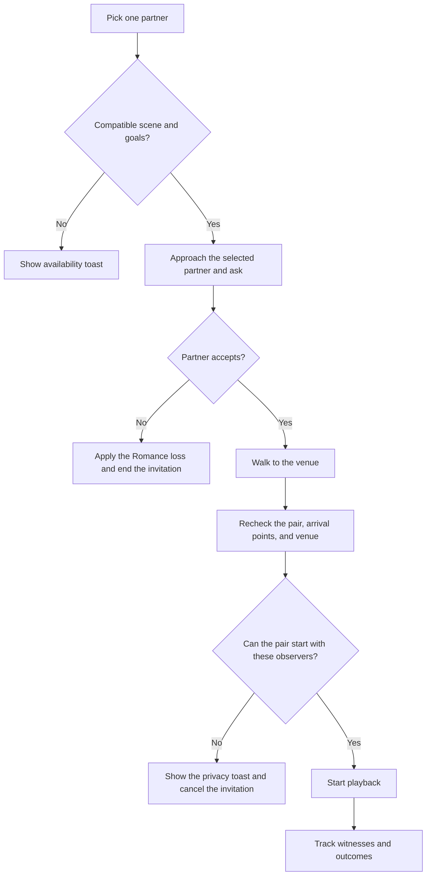

# HZoi Gameplay encounter design

**Status:** Proposed, iteration 1

Iteration 1 supports encounters between exactly two Zois. HZoi Gameplay owns invitations, venue selection, witness reactions, and gameplay consequences. SceneZOI owns placement, playback, task progress, and cleanup. Installed content packs determine which rosters and venues can play a scene. Iteration 1 is complete when every item and acceptance check below passes for that two-Zoi scope.

## Player interaction

Add **Have Sex Here** with a burning-heart icon to SceneZOI-supported beds and sofas and to walkable ground. Show it for a Young Adult or older initiator. Apply the same eligibility rule to picker candidates.

Keep eligibility in one easily configurable rule, because mods or updates may possibly add life stages. An unknown stage needs an explicit "is eligible" mapping. Ghosts are handled through separate native life-state interfaces, and supernatural Zois (likely coming from mods) such as a succubus, a vampire, an alien, may be implemented similarly. [Growth step enum](https://mod-docs.playinzoi.com/docs/modkit-docs/wiki/structguide/enum/eb1growthstep/) · [Life component](https://mod-docs.playinzoi.com/docs/modkit-docs/wiki/luaapi/b2/components/fb2lifecomponent/).

Open the same native picker as SceneZOI’s debug starter. The selected pair must include the controlled Zoi and one partner. The picker returns the partner to HZoi Gameplay so it can run the invitation. Existing gameplay groups stay intact. Keep the roster representation compatible with more roles for later packs. [SceneZOI picker and group behavior](https://github.com/acepleiades/SceneZOI/blob/main/docs/group-support.md#solo-launcher-and-debug-picker).

### Content check and invitation

Resolve the actual roster, role bindings, and selected venue before the invitation. Require a compatible route to one `excitement` completion for each Zoi. The current content is expected to cover male/female pairs. Let male/male and female/female pairs reach the same check and show **No compatible scenes are available for these Zois at this spot** when no route exists. Content updates can enable those pairs without a gameplay rule change. Handle busy Zois, occupied furniture, and unreachable locations as temporary availability failures.

The picker chooses whom to ask. The initiator then walks up to the selected partner and asks through an interaction modeled on inZOI’s **Set the Mood Next to Bed**. Use the native approach dialogue and match the social eligibility, branch order, and acceptance/refusal weights from `Co_TryTo_Mood_Lover` and `Co_TryTo_Mood_Spouse`. HZoi’s venue and adult-eligibility checks supply the equivalent context for ground and supported furniture. [Vanilla romance reference](inzoi-romance.md) · [Interaction branches](inzoi-romance-interactions.csv).

- **If the partner accepts**, have both Zois walk to separate arrival points at the selected venue. Once both arrive, recheck eligibility, arrival, and furniture availability, then apply the [arrival privacy check](#arrival-privacy-check) before requesting SceneZOI playback. Acceptance alone gives no Romance bonus.
- **If the partner refuses**, play the refusal branch, apply the [Romance loss](#romance-changes) when the refusal happens, and end the invitation there. For two Zois who can otherwise use the interaction and have no established romantic relationship, a Romance score below 30 always takes this branch.

### Group invitations

How acceptance and refusal work for encounters with three or more Zois is undecided. Group venue approach and Romance rewards also need their own rules. Three or more participants are outside iteration 1. Define that flow when the picker supports selecting more than one partner.

## Playback and consequences

Use the same `start_autonomous_scene` request for player and NPC encounters. Initial sexual activity uses approved non-penetrative and non-coital penetrative actions from SceneZOI's `sexual_activity` metadata. Stages 1–2 prioritize those clips and can start with intercourse if that provides a better goal route. Stages 3–4 prioritize vaginal intercourse and in iteration 1 permit anal intercourse for a male/male pair. SceneZOI prefers variety among reachable clips in the same priority tier and verifies that every participant’s goal can be completed along one route. [Request and automatic action policy](autonomous-scene-start.md).

The leading participant's Excitement progress makes stages 2–4 due at 25%, 50%, and 75%. Each stage selects its playback speed from 0.5×, 1×, 1.5×, and 2×. The scene and the user's task settings govern Excitement gain. A Zoi can complete again while others catch up. When all goals are complete, Auto waits six seconds at Normal simulation speed and allows any active completion effects to settle. Exit restores each Zoi to the corresponding arrival transform. [SceneZOI start and plan API](https://github.com/acepleiades/SceneZOI/blob/main/docs/addons.md#autonomous-scenes).

The player can select a controllable participant, turn off Auto, and navigate the compatible authored scenes. While in manual control, reaching all goals keeps playback running. Manual Exit determines the outcome from the recorded completions. Re-enabling Auto after completing all goals during manual control exits as soon as active completion effects settle.

Correlate `session_started` with the original request. Read per-Zoi `plan.goals` and `result_facts.task_state` on `session_ended`, with `get_session_result` for a missed event. Apply the final Romance bonus and outcome moodlets once after confirmed cleanup. Process needs and urge fulfillment during playback. Keep the stop reason alongside the completion counts. A missing result leaves any unobserved outcome unknown. [SceneZOI outcomes](https://github.com/acepleiades/SceneZOI/blob/main/docs/addon-controls.md#observation-and-outcomes).

Action-specific urges, contraception, and pregnancy effects stay out of iteration 1.

### Romance changes

For the iteration 1 invitation, use inZOI’s **Set the Mood Next to Bed** relationship effects as the reference. HZoi requests −5 for refusal, +5 for partial success, and +10 when both Zois complete. The native branch uses Romance when there is no family relationship and Family for spouses. The game applies its normal relationship limits to the additive change from initiator to partner. Verify both score directions in game. [Set the Mood Romance effects](inzoi-romance.md#set-the-mood-romance-effects).

| What happened | Romance change |
| --- | --- |
| The partner refuses | Apply the native-style loss once as soon as the conversation confirms the refusal. |
| The partner accepts | Wait for the actual outcome. |
| The scene fails to start, or the invitation is canceled or unavailable | No change. |
| Playback ends normally or through a normal Exit, and neither Zoi completes their goal | No bonus. |
| Playback ends normally or through a normal Exit, and one Zoi completes their goal | Apply the small bonus after cleanup. |
| Playback ends normally or through a normal Exit, and both Zois complete their goals | Apply the full bonus after cleanup. |
| A technical failure, game lifecycle event, or unknown result ends the session | No final Romance bonus. Verified needs, Urge fulfillment, and witness incidents still count. |

Count how many distinct participants completed their goal. Two completions by the same Zoi still count as partial success. Apply at most one Romance outcome per invitation. Use the verified end result for manual Exit and a normal Exit requested by a witness reaction, too. Check the reused native dialogue and our own writes together so refusal applies exactly once and acceptance never grants early Romance. Any separate cheating effect still follows the native witness rules.

### Needs on each Excitement completion

The live v0.11.2 bed sequence gives each Zoi the three costs through `Delay_30_MakeLove → MakeLove_AddStat` and the two gains through `Co_TryTo_Mood → Mood_Success`. The separate, conditional `Co_Mood_After` follow-up adds 10 Fun and 10 `Admit` to both Zois. Use the main interaction's five deltas for this milestone.

| Need | Native delta per Zoi | HZoi delta per completion |
| --- | ---: | ---: |
| Hunger (`Hunger`) | −50 | −12.5 |
| Hygiene (`Cleanliness`) | −50 | −12.5 |
| Energy (`Energy`) | −50 | −12.5 |
| Fun (`Fun`) | +10 | +5 |
| Social (`Society`) | +10 | +5 |

Apply the deltas during playback to the Zoi who completed the task. Each completion is independent of the other Zoi's result and of the eventual stop reason. Deduplicate using session ID, participant ID, task ID, and completion index. For a cost, apply at most the amount available above 33% of the configured need range. On the current −100 to +100 scale that floor is −34. A protected need already at or below 33% stays at its current value when HZoi applies the costs. Gains cap at the need maximum. Read the current value at each completion and verify the write path preserves the clamp even with native modifiers. Let natural decay continue throughout the scene, including below 33%. [SceneZOI completion events](https://github.com/acepleiades/SceneZOI/blob/main/docs/scene-tasks.md#completion-and-subscriptions) · [Native stat interface](https://mod-docs.playinzoi.com/docs/modkit-docs/wiki/luaapi/b2/components/fb2statcomponent/) · [AddStat rules](https://mod-docs.playinzoi.com/docs/modkit-docs/wiki/script-execution/exec-addstat/).

## Urges and NPC initiative

NPC invitations respect inZOI's master autonomy setting for both participants. Use the resolved per-Zoi preference, including inherited settings, and require both Zois to be available. Recheck before the invitation and again during preparation. If autonomy is turned off while an NPC attempt is pending, stop the attempt, release the venue, and leave the Urge pending. An encounter already playing can finish. Player-directed invitations use the normal invitation rules.

The game stores Urges as `Hope` rows with owner and target conditions, a lifetime, a cooldown group, and a mission. The closest match in the live build is `Trait_Needy_LoveLover`. It selects for an awake Emotionally Needy Zoi with a named lover, outside a rabbit hole, prison, site event, and the desert island. Its target must pass romantic eligibility and be a named lover at Romance below 30. The native row has a 12-hour lifetime and the `HopeCool_2Day` group. Its target-bound mission counts one `Event_MakingLove` talk. Carry those conditions over as the initial HZoi urge rules and apply the Youth-or-older policy to both Zois. For an NPC's invitation, also require the ordinary **Set the Mood** invitation rules and a feasible private venue. The urge makes a valid invitation more likely and can remain pending while a venue is unavailable. [Krafton's Urge selection notes](https://playinzoi.com/en/news/9309) · [Hope component](https://mod-docs.playinzoi.com/docs/modkit-docs/wiki/luaapi/b2/components/fb2hopecomponent/).

Store the urge owner, selected partner, and expiry. Subscribe to `task_completed`. Satisfy the active urge during the scene when the **owner** completes `excitement` and the **selected partner** is in the session roster. Either Zoi can initiate the iteration 1 invitation. Acceptance, walking to the venue, or a completion by only the partner leaves the urge active. A later interruption leaves an earned completion intact.

The native `Hope` test loaded the custom row, but forced selection left its
partner and mission target IDs unset. Iteration 1 uses
[HZoi-owned Urges](../prototype/queen-bed/owned-urges.md) with the original
reward. The offer and cooldown are scoped to the current loaded world.

## NPC privacy and venue selection

For autonomous invitations, search reachable indoor rooms on the same residential site as both Zois. Rooms with and without an assigned purpose can qualify. Both Zois need permission to enter and separate walkable arrival points in the room. The location must support a compatible scene route, the room must be available to claim, and any bed or sofa seats selected must be free and available to reserve.

1. Search rooms that contain no other Zois. Finish this pass before considering occupied rooms, even if the best vacant option is standing and a bed is available in an occupied room.
2. If no vacant candidate qualifies, search occupied rooms with the same location, access, compatibility and reservation checks. Apply the existing [arrival privacy check](#arrival-privacy-check) before playback. Skip the attempt if neither pass finds a candidate.

Use the same ranking in each pass and prefer the nearest eligible option within each tier.

1. The initiator's assigned bed, if compatible and available.
2. Any compatible double bed.
3. Any compatible single bed.
4. A compatible sofa with an available adjacent seat pair.
5. A standing scene with two separate, reachable walkable spots inside the room. The room may contain furniture that was unavailable or unsuitable.

Read native bed assignments for the first tier. When the initiator has no eligible assigned bed in the current pass, use the remaining tiers. The partner's assignment and other bed assignments do not add tiers. Use `find_furniture` for availability and playback preflight for scene compatibility. Use `FB2Site:IsSameRoom` with the venue point and loaded Zois' positions to distinguish room occupancy from furniture occupancy. Validate indoor room membership, floor boundaries, native permissions and both walking paths. [Site API](https://mod-docs.playinzoi.com/docs/modkit-docs/wiki/luaapi/b2/structs/fb2site/) · [Room scan](https://mod-docs.playinzoi.com/docs/modkit-docs/wiki/cli/build/build-scan-floors/).

Hold the room claim during preparation and playback. Recheck the selected furniture and seat pair at arrival, then evaluate everyone who can see either arrival point, including Zois who entered after the claim. Cancel and release the claim if a visible observer fails the check. Keep reservations and outcomes independent when sessions overlap.

**Vanilla comparison.** The reported **Suggest Having a Baby** attempt worked after the player cleared the bedroom and invited Seoyun in the living, dining, and kitchen area. The inspected `CanPregnancy_NoSpouse` condition has a double-bed presence check. The sequence then finds a bed through `AutoFind_Double_Bed` and `Sleep_Bed`. The inspected rows expose no room-vacancy predicate, so the toast's cause remains unresolved. The NPCs in the room may have been occupying the path. A controlled retry should change room occupancy alone, verify the same bed and slots are available, and capture the exact toast and failed sequence step.

## Arrival privacy check

After an accepted invitation, let all participants reach their separate arrival points. Once the roster and venue pass the final availability checks, scan loaded Zois outside the session within nine meters of an arrival point. A clear trace to any arrival point from the observer's viewpoint counts. Check immediately before requesting playback so the result covers Zois who arrived while the pair was walking. Both the arrival and playback checks trace against the game's Visibility and WorldStatic collision channels. A sightline is clear only when both channels are clear. This covers walls that block WorldStatic even when Visibility passes through. If a trace or score lookup fails, retry briefly and, if still unresolved, cancel as a technical start failure. A missing relationship counts as below the threshold.

The game can leave a door's invisible access blocker in the opening even when the door is open. When a sight trace hits that blocker, check the door's physical components at their current positions and continue the trace if the gap is clear. A closed door, a leaf across the sightline, and other geometry behind the doorway still block sight. An open gap can expose an arrival spot or an ongoing encounter.

For each visible observer, read the raw relationship scores **from the observer toward each participant**. Score bands and official partner status are separate. Live scores can differ in the two directions. Use the same direction at arrival and during playback. [Vanilla relationship scores](inzoi-romance.md#read-the-romance-state-correctly).

An observer qualifies through either of these routes:

1. **Romance ≥30 with every participant**.
2. At least one participant is of the opposite sex to the observer. Require **Romance ≥30 with every opposite-sex participant** and **Friendship ≥30 with every same-sex participant**.

Every visible observer must qualify independently. An observer who qualifies with only some participants can still block the start. One observer's scores cannot make up for another's. If every participant is of the same sex as the observer, use the all-Romance route. The split route always requires a real Romance score of at least 30. This keeps the arrival check score-based and prevents Friendship alone from qualifying a child or teen who cannot build Romance with the adult participants under the base game's rules.

With no visible observers, the encounter can start. Apply the same check to player and NPC invitations. A player can choose a supported public venue and start if everyone who can see qualifies. NPCs search indoor residential rooms and prefer to keep other Zois out of the room by selecting a vacant venue first.

If an observer fails the check, cancel before SceneZOI starts. For a player-directed attempt or one involving the controlled Zoi, show just the localized toast **They need more privacy.** Save overhead reactions for sightings during playback. Clear the pending actions and release any reservation. Romance stays as it was, and an NPC's Urge remains pending.

A non-partner who qualified at arrival and stays in view does not immediately count as a walk-in. This matters for someone admitted on Friendship alone. If they leave and come back into view, apply the walk-in rules to that new sighting. An official partner can qualify at arrival under the same score check. If they then see an intimate action during playback, the existing cheating rules apply. An attempt canceled before playback creates no cheating incident.

## Witnesses and cheating

Check loaded Zois outside the roster while a directed intimate action is playing, including late arrivals. Use the directed action and participant IDs from `Client.actions(snapshot)`. A verified walk-in requires a clear sightline from the witness's viewpoint to both Zois in the action, using the same collision channels as the [arrival check](#arrival-privacy-check). Distance only bounds the search. A blocked or unavailable trace leaves the encounter unwitnessed for that check. Verify wall and door behavior under different camera and simulation states. [SceneZOI witness example](https://github.com/acepleiades/SceneZOI/blob/main/docs/addon-authoring.md#a-romantic-partner-catches-the-encounter) · [Native trace API](https://mod-docs.playinzoi.com/docs/modkit-docs/wiki/luaapi/b1/classes/ub1functionlibrary/).

### What the witness does

Check official partner status first. Otherwise, use the witness's **highest** Romance score toward either participant to choose their own reaction. At exactly 30 or 60, use the higher band.

| What the witness sees | Reaction |
| --- | --- |
| Their official partner with someone else | Pick a betrayed line and preserve the native cheating reaction and consequences. |
| Romance below 30 with both | React with surprise, say a line about walking in on something private, and prefer to leave. |
| Highest Romance is 30 to below 60 | React with surprise, say a more familiar line, and prefer to leave. |
| Romance is 60 or higher with either | React with surprise and say a light, familiar line. Keep their existing task or let them continue using the space. |

Keep the ordinary **Unexpected Company** surprise moodlet in all three ordinary bands. For witnesses who prefer to leave, only queue a walk-away for an idle NPC with a reachable spot. Let a controlled Zoi, an NPC with a task already running, or a participant in another session keep their actions. The witness's life stage controls only the HZoi speech bubble. From the Teenager stage (`HighTeen`) onward, choose one localized line at random from the applicable pool on the first eligible sighting per witness and session. Younger witnesses, including the Adolescent stage (`LowTeen`), use the same score-based reaction and walk-away preference without a witness bubble. Keep the witness's own bubble separate from participant trait dialogue and the native affair confrontation. [ModKit life stages](https://mod-docs.playinzoi.com/docs/modkit-docs/wiki/structguide/enum/eb1growthstep/).

### How the participants react

Evaluate stop votes for each verified sighting. For an ordinary witness, each participant applies their own trait preference. If that witness has **Romance ≥30 toward that participant**, the participant skips their stop vote and any negative reaction specific to being seen by that witness. This also skips a participant trait complaint for that sighting. A positive witness moodlet can still apply under its own conditions, and completion, mismatch, and native cheating consequences keep their existing rules.

For example, a Perfectionist and a Recluse would both vote to stop when an unfamiliar Zoi walks in. If the witness has Romance 30 with only the Recluse, only the Perfectionist votes to stop, and the Recluse gets no **Nowhere to Hide** moodlet from that sighting. If the witness has Romance 30 with both, neither votes to stop. Use the specific witness-to-participant score here, even if the witness has a higher score with the other participant.

HZoi requests ordinary Exit only if **more than half of the full roster** votes to stop over the same sighting. Participants who vote to stop that encounter and have no trait-specific line say “They walked in at the worst moment.” One of two is a tie, and playback continues. Evaluate later witnesses separately. Two separate one-vote sightings cannot be added into a majority, and familiarity with one witness cannot erase the reaction to another. Issue at most one Exit request. The player can still Exit normally.

For a verified official-partner sighting, each participant defaults to stopping. The **Rulebreaker trait or the Flirt characteristic** is enough for that Zoi to prefer to continue, even when their own official partner is the witness. Each participant counts once. This sighting takes priority over ordinary sightings in the same check. When HZoi requests Exit, pass a localized reason that distinguishes an ordinary walk-in from getting caught by an official partner. Whether playback stops is independent of recording the cheating incident.

### Witness speech bubbles

For a witness at the Teenager stage or older, choose one line from the matching group. The lines apply across traits. Use the same lines for pairs and larger groups.

**Official partner detects cheating**

- “I trusted you. How could you?”
- “I can’t believe you’d do this to me.”
- “I never thought I’d catch you in the act.”
- “I thought what we had meant something.”
- “Is this what you’ve been doing behind my back?”

**Romance below 30 with every participant**

- “Oh! Sorry, I’ll give you some privacy.”
- “I didn’t mean to walk in on this.”
- “Oh! I saw more than I meant to.”
- “Sorry. I’ve clearly come at a bad time.”
- “Oh! This looks private. I’ll come back later.”

**Highest Romance is 30 to below 60**

- “Oh, hey! I’ll let you have your moment.”
- “Of all the times to drop by! I’ll catch up with you later.”
- “Oh! No need to explain. I’ll give you some space.”
- “Ah, so that’s what you were up to. I’ll leave you to it.”
- “Oh! I can take a hint. See you later.”

**Romance 60 or higher with at least one participant, no official partnership**

- “Oh! Getting pretty cozy in here.”
- “Well, that’s a little more than flirting.”
- “Oh! I see what kind of mood everyone’s in.”
- “Well! It’s getting warm in here.”
- “Oh! Here I thought you were just talking.”

### Native cheating reaction

Record a confirmed official-partner incident as soon as the witness sees the encounter. Use `Youth_Lover`, engagement, or spouse. Capture the witness, their involved partner, the other participant, and the session ID. Deduplicate by session, witness, and involved partner. The stop preference decides playback. The verified sighting decides cheating.

After ordinary exit and cleanup, deliver the same confirmed-affair reaction that **Set the Mood** uses. Call `OnReceiveHowling("Howling_Affair_Confirmed", involvedPartnerId)` on the witness's Howling component with the recorded roles. Queue this same handoff when a scene continues and deliver it when the session ends. Preserve native trait reactions, records, flags, and score consequences. Validate the third-participant handoff before relying on native three-Zoi confrontation. If the directed call fails after a verified sighting and correct role handoff, retain the HZoi incident, log delivery and cooldown details, and investigate a possible inZOI defect. [Vanilla test findings](inzoi-romance.md#conclusions-from-the-tests) · [Native Howling API](https://mod-docs.playinzoi.com/docs/modkit-docs/wiki/luaapi/b2/components/fb2howlingcomponent/).

## Outcome moodlets and personality

The encounter outcome determines each Zoi’s default moodlet. Their traits can change the mood or its strength. Each moodlet has a title, reason text, emotion, point value, and duration.

| Per-Zoi result | Proposed default | In-game tooltip |
| --- | --- | --- |
| Everyone completes | **In Sync**, Content for each Zoi. | [From everyone reaching orgasm] You found a rhythm that felt right for everyone. Afterward, you wanted to stay close a little longer. |
| This Zoi completes and others are still short of their goals | **Satisfied**, a milder Content moodlet. | [From reaching orgasm when some participants didn’t] You feel relaxed and satisfied. You wish everyone had had the same chance to finish. |
| Someone else completes and this Zoi does not | **Out of Sync**, mild Sad. | [From someone else reaching orgasm while you didn’t] It was good to see someone finish, but you were still getting there when it ended. You wish you’d had a little more time. |
| Nobody completes and an ordinary sighting stops the session | **Awkward Timing**, Flustered, for a participant whose Romance familiarity did not suppress the reaction to the stopping witness. | [From being interrupted during sex] Someone saw what was happening, and the encounter stopped. It’s hard to get back in the mood after that. |
| Nobody completes and a participant ends it | **Unfinished Moment**, mild Sad. | [From stopping early] Things were only just getting good when you stopped. You’re left thinking about what might have happened with a little more time. |
| Official partner catches the encounter | Native cheating moodlets and consequences. A trait can contribute an HZoi reaction. | — |
| An observer fails the arrival privacy check | Cancel the attempt before playback, release the venue, and leave Romance and any pending Urge alone. Show the localized toast when the player is involved. | — |
| SceneZOI fails to start or ends for a technical reason, including a mid-scene timeout | Use technical feedback and diagnostics and let SceneZOI run cleanup. The failure adds no moodlet, relationship, need, or urge effect. Verified completions and sightings still count. | — |
| Game lifecycle ends the session, such as saving, opening Create a Zoi, or unloading the mod | End neutrally. Preserve any verified completions and sightings. Teardown may leave the final result unavailable. | — |

Keep a completion result and a stop reason separately. A Zoi can earn satisfaction before an interruption and still react to being seen. Apply at most one HZoi outcome moodlet and one distinct witness moodlet per Zoi. When several traits match, use the most specific rule and break ties with the core personality. Iteration 1 uses current outcomes, current witness type, moodlet adjustments, speech bubbles, and stop preferences. The trait rules need no venue history, follow-up activities, or schedule changes.

Evaluate a completion moodlet from the perspective of the Zoi receiving it. When someone else completes and this Zoi does not, trait variants can express sadness, frustration, or anxiety and can soften the intensity. Witness moodlets use the sighting and the Zoi's response to it. Suppress negative ordinary-witness moodlets such as **Nowhere to Hide**, **Exactly What I Worried About**, or **Who Let Them In?** for a participant when the witness has Romance ≥30 toward them. Apply the same rule to **Awkward Timing**. Decide whether each sighting qualifies before choosing a final moodlet, so a later familiar witness cannot clear an earlier unfamiliar sighting.

### SceneZOI failure signals

| Stage | Examples from the checked SceneZOI code |
| --- | --- |
| Start or preparation | `session_start_failed` with `start_failed` for startup errors such as missing assets or a timed-out start bridge. After session allocation, participant preparation or binding can fail (`prepare_error`, `binding_error`) or a preparation barrier can time out (`prepare_timeout`, `appearance_timeout`, `attachment_timeout`, `outfit_timeout`). Some of these barriers also run during scene changes. [Start handling](https://github.com/acepleiades/SceneZOI/blob/6228dbd6d584c27cacce42dd0fc12b6ab6f018eb/modkit/SceneZOI_93C44199/workspace/lua/B1/SceneZOI/AddonAPI.lua#L68) · [Preparation barriers](https://github.com/acepleiades/SceneZOI/blob/6228dbd6d584c27cacce42dd0fc12b6ab6f018eb/modkit/SceneZOI_93C44199/workspace/lua/B1/SceneZOI/Runtime.lua#L1351). |
| Playback | A runtime update error (`runtime_error`), a failed transition destination (`transition_destination_error`), an unavailable goal route or stage (`goal_unreachable`, `required_stage_unavailable`), a stall or budget limit (`no_progress`, `playback_budget_exceeded`), a disconnected UI (`ui_disconnected`), a lost participant or changed furniture (`participant_unloaded`, `furniture_changed`), or an expired session or owner lease (`lifetime_expired`, `owner_expired`). [Planner stops](https://github.com/acepleiades/SceneZOI/blob/6228dbd6d584c27cacce42dd0fc12b6ab6f018eb/docs/addons.md#end-policies-and-safety-stops) · [Runtime stop checks](https://github.com/acepleiades/SceneZOI/blob/6228dbd6d584c27cacce42dd0fc12b6ab6f018eb/modkit/SceneZOI_93C44199/workspace/lua/B1/SceneZOI/Runtime.lua#L1333) · [Runtime error handler](https://github.com/acepleiades/SceneZOI/blob/6228dbd6d584c27cacce42dd0fc12b6ab6f018eb/modkit/SceneZOI_93C44199/workspace/lua/B1/SceneZOI/Runtime.lua#L1507). |
| Cleanup | `restore_error` or `restore_timeout` in `result_facts.cleanup_code`. Keep this separate from the original `result_facts.stop_reason` so a cleanup failure preserves the reason the session ended. Wait for confirmed restoration before queuing native reactions on the participants. [Outcome fields](https://github.com/acepleiades/SceneZOI/blob/6228dbd6d584c27cacce42dd0fc12b6ab6f018eb/docs/addon-controls.md#observation-and-outcomes). |

Use `session_start_failed` or `session_ended` to settle the encounter. A recoverable `task_route_failed` notification can leave playback running. A missing terminal event or an unrecognized end reason leaves any unverified outcome unknown. [Task-route handling](https://github.com/acepleiades/SceneZOI/blob/6228dbd6d584c27cacce42dd0fc12b6ab6f018eb/modkit/SceneZOI_93C44199/workspace/lua/B1/SceneZOI/Runtime.lua#L859) · [SceneZOI events](https://github.com/acepleiades/SceneZOI/blob/6228dbd6d584c27cacce42dd0fc12b6ab6f018eb/docs/addons.md#events-and-ownership).

### All core traits

The live `Trait` table has 18 `Nature` rows. The reactions below are HZoi proposals. Mood names use the in-game labels. [Krafton's trait ID reference](https://playinzoi.com/en/guide/cheats#trait--characteristic-id).

| Trait | Trigger | Iteration 1 reaction | In-game tooltip |
| --- | --- | --- | --- |
| Perfectionist (`Perfectionist`) | Some participants complete, or the encounter is seen | **Out of Order** adds Annoyed on a mismatch. When seen, prefers to stop and says “Could you knock next time?” | [From the encounter ending before everyone reached orgasm] You wanted everyone to enjoy it. Ending before everyone could finish made the whole thing feel a little uneven. |
| Innovator (`Activist`) | Everyone completes | **Found a Better Rhythm** adds +2 to `Curious`. | [From everyone reaching orgasm] Changing things up came naturally once you started paying attention to each other. You’re glad you tried something different. |
| Recluse (`Helper`) | Encounter is seen | **Nowhere to Hide** adds Flustered (`Cringing`). Prefers to stop and says “I wanted a moment to ourselves.” | [From being seen having sex] You thought you had some privacy. The second you realized someone could see you, you wished you could disappear. |
| Charmer (`Romantic`) | Earns a positive completion moodlet | Add one point to that moodlet's usual strength. | — |
| Socialite (`Popular`) | Ordinary witness | **Played It Cool** adds Content. | [From being seen having sex] Being seen was awkward for a second, but you kept your cool. It doesn’t feel like something you need to make a big deal of. |
| Go-Getter (`Achiever`) | Nobody completes before a participant ends the scene | **Unfinished Business** adds Annoyed. | [From stopping early] You were just getting into it when things stopped. The feeling that you left something unfinished is hard to shake. |
| Visionary (`Artist`) | Everyone completes | **Perfect Improvisation** adds Curious. | [From everyone reaching orgasm] You stopped thinking about how it ought to go and followed each other’s lead. Now you’re curious what else might feel that natural. |
| Individualist (`Independent`) | This Zoi completes, whether or not the other Zoi does | **At My Own Pace** adds Content. | [From reaching orgasm] You gave yourself time to enjoy being close without worrying about how fast things were moving. That was exactly what you needed. |
| Explorer (`Observer`) | This Zoi completes | **Something to Think About** adds Curious. | [From reaching orgasm] You keep thinking about what made that feel so good. It might be worth talking about what you liked next time. |
| Intellectual (`Intellect`) | Someone else completes and this Zoi does not | **A Question of Timing** adds Nervous. | [From someone else reaching orgasm while you didn’t] Someone finished just when you were starting to get close. You’re still wondering how the timing got so out of step. |
| Sentinel (`Risk-averse`) | Encounter is seen | **Exactly What I Worried About** adds Nervous. Prefers to stop. | [From being seen having sex] You’d been wondering whether someone might see you, and then it actually happened. It’s going to take a while to stop worrying about it. |
| Rulebreaker (`Cooperator`) | Encounter is seen | Prefers to continue. If their official partner is the witness, **Thrill of Being Caught** adds Excited alongside the native reaction. | [From getting caught cheating] Your partner caught you with someone else. You know the conversation won’t be easy, but the rush caught you by surprise. |
| Troublemaker (`Entertainer`) | Ordinary witness | **What an Entrance** adds Amused. | [From being seen having sex] The timing was so bad that it was almost funny. Once the surprise wore off, you had to fight the urge to laugh. |
| Adventurer (`Adventurer`) | Everyone completes | **Worth the Rush** adds Excited. | [From everyone reaching orgasm] Getting carried away together felt better than you expected. Your heart is still racing a little just thinking about it. |
| Authoritarian (`Arrogant`) | Encounter is seen | **Who Let Them In?** adds Annoyed. Prefers to stop. | [From being seen having sex] You expected a bit of privacy. Now you’re thinking about how easily someone saw you and how annoyed you are about it. |
| Leader (`Leader`) | An ordinary sighting stops the scene | **Kept It Together** adds Confident. | [From being interrupted during sex] You were embarrassed at first, but you took a breath and kept your composure. It feels good to know you can handle an awkward moment. |
| Pacifist (`Peacemaker`) | Someone else completes and this Zoi does not | **Mixed Feelings** adds mild Sad. Prefers to stop when seen. | [From someone else reaching orgasm while you didn’t] You’re glad someone had a good time. You wish you’d had a little more time too. |
| Idealist (`Dreamer`) | Everyone completes | **The World Went Quiet** adds Content. | [From everyone reaching orgasm] For a little while you forgot about everything outside that moment. You’re still carrying that quiet feeling with you. |

### Characteristics and aptitudes

Each row proposes a moodlet or a stop preference using the same outcome data. The four toddler-only rows `Baby_Troublemaker`, `Baby_Innocent`, `Baby_Cuty`, and `Baby_Feisty` stay outside encounter eligibility.

| Characteristic | Iteration 1 reaction | In-game tooltip |
| --- | --- | --- |
| Extroverted (`Extrovert`) | **Let’s Laugh About It** adds Amused after an ordinary sighting. | [From being seen having sex] It was embarrassing to realize someone could see you, but the timing was hard to take seriously. You can already laugh about it. |
| Introverted (`Introvert`) | **Too Many Eyes** adds Flustered when seen. Prefers to stop. | [From being seen having sex] The moment felt private until you noticed someone looking. You’d rather be somewhere quiet where you don’t have to face anyone for a bit. |
| Cheerful (`Cheerful`) | **A Little Letdown** adds mild Sad when someone else completes and this Zoi does not. | [From someone else reaching orgasm while you didn’t] You enjoyed the closeness. It’s still a little disappointing to stop when you were getting close. |
| Depressed (`Gloomy`) | **A Little Light** adds Content when everyone completes. | [From everyone reaching orgasm] Feeling wanted and close to someone gave you a break from the things weighing on you. You’re glad you had that time together. |
| Clumsy (`Clumsy`) | **That Was Awkward** adds Flustered when an ordinary sighting stops the scene. | [From being interrupted during sex] The second you noticed someone watching, you forgot where to look. Just remembering the awkward silence makes you cringe. |
| Bookworm (`Bookworm`) | **A Chapter Worth Keeping** adds Moved when everyone completes. | [From everyone reaching orgasm] It’s the little details you’ll remember, like the look you shared afterward. You’re glad you got to spend that time together. |
| Emotionally Needy (`Needy`) | **Stay Close** adds Sad when someone else completes and this Zoi does not. | [From someone else reaching orgasm while you didn’t] Someone finished while you were still getting there. You’d like a little reassurance and a moment to stay close. |
| Fitness Enthusiast (`Active`) | **Found Our Pace** adds Excited when everyone completes. | [From everyone reaching orgasm] Once you found a pace that felt good to everyone, everything clicked. You still feel the rush now that you’ve caught your breath. |
| Lively (`Energetic`) | **Still Buzzing** adds Excited when this Zoi completes in a partial outcome. | [From reaching orgasm when some participants didn’t] Even though the encounter ended early for some, you came away with more energy than you expected. Sitting still doesn’t sound very appealing right now. |
| Neat Freak (`CleanFreak`) | **Could Use a Shower** adds Uncomfortable if Hygiene is low at exit after an earned completion. | [From feeling sweaty after sex] You had a good time, but now everything feels a little sticky. A warm shower and a change of clothes sound wonderful. |
| Childish (`Childish`, adult Zoi) | **Couldn’t Keep a Straight Face** adds Amused after an ordinary sighting. | [From being seen having sex] You knew you should probably look serious, but the surprise got the better of you. Thinking about it still makes you want to giggle. |
| Genius (`Genius`) | **Missing Piece** adds Annoyed when someone else completes and this Zoi does not. | [From someone else reaching orgasm while you didn’t] You can’t help replaying what happened. Someone finished, and you’re frustrated that you can’t work out what was missing for you. |
| Slacker (`Lazy`) | **Good Enough for Me** adds Content when this Zoi completes in a partial outcome. | [From reaching orgasm when some participants didn’t] You got what you needed and now you’re happy to take it easy. A few quiet minutes to yourself sound pretty good. |
| Materialistic (`Snob`) | **A Little Luxury** adds Content when everyone completes in a furniture scene. | [From everyone reaching orgasm] Having somewhere comfortable made it so much easier to relax together. You could get used to taking your time like that. |
| Malicious (`Mean`) | **I Got Mine** adds Amused when this Zoi completes in a partial outcome. | [From reaching orgasm when some participants didn’t] You noticed some hadn’t finished when it ended. You’re still feeling pretty smug about how well things went for you. |
| Workaholic (`Workaholic`) | **A Break Well Spent** adds Content when everyone completes. | [From everyone reaching orgasm] You managed to put everything else aside and give each other your full attention. It was worth making room for that. |
| Flirt (`Flirt`) | Prefers to continue when seen, including by their own official partner. **Cool Under Pressure** adds Amused after an ordinary sighting. | [From being seen having sex] You caught someone looking and felt more amused than embarrassed. A little awkwardness wasn’t enough to ruin the moment for you. |
| Devoted (`Faithful`) | **What Have I Done?** adds Sad when caught by their official partner. Prefers to stop. | [From getting caught cheating] Getting caught made it sink in how much you’d hurt your partner. You wish you could take back what just happened. |

| Aptitude ID | Iteration 1 reaction | In-game tooltip |
| --- | --- | --- |
| `Aptitude_Peace` | **Quiet Again** adds Content when an ordinary sighting stops the scene. | [From being interrupted during sex] Things got tense when you realized someone had seen you. Now that you’ve stopped, you’re glad to have a moment to breathe. |
| `Aptitude_Wikipedia` | **Well, Now I Know** adds Curious when this Zoi completes in a partial outcome. | [From reaching orgasm when some participants didn’t] Finishing made you think about how much your own preferences matter. You’d like to compare notes sometime. |
| `Aptitude_Seeker` | **Worth the Detour** adds Excited when everyone completes. | [From everyone reaching orgasm] Taking a little time out of the day turned into something you’ll be smiling about later. You’re glad you went for it. |
| `Aptitude_Casanova` | **A Good Impression** adds Aflutter when everyone completes. | [From everyone reaching orgasm] Knowing everyone enjoyed it gave you butterflies. You’re still thinking about the looks you shared afterward. |
| `Aptitude_CoffeeMaster` | **A Pleasant Buzz** adds Excited when this Zoi completes in a partial outcome. | [From reaching orgasm when some participants didn’t] You thought you might feel sleepy afterward, but your body is still humming with energy. It’s a pleasant surprise. |
| `Aptitude_BakingMaster` | **Sweet Finish** adds Content when everyone completes. | [From everyone reaching orgasm] You took your time and it paid off for everyone. You’re in no hurry to move on from how good that felt. |
| `Aptitude_BeverageMaster` | **Taking It Easy** adds Content when an ordinary sighting stops the scene. | [From being interrupted during sex] It was tense when someone noticed what was happening. After stopping and taking a breath, you’re ready to let the awkwardness pass. |
| `Aptitude_Collect` | **A Memory to Keep** adds Moved when everyone completes. | [From everyone reaching orgasm] You’ve already caught yourself smiling at the memory of being that close. It’s one of those moments you’d like to hold on to. |
| `Aptitude_Fishing` | **Better Luck Next Time** adds mild Sad if a participant ends the scene and nobody completed. | [From stopping early] Things ended before anyone could finish. You’re disappointed, but maybe you’ll have better luck when there’s more time. |
| `Aptitude_Smith` | **Found the Fit** adds Focused when everyone completes in a furniture scene. | [From everyone reaching orgasm] Once you found a comfortable position, you could pay attention to each other. You’ll remember what worked next time. |
| `Aptitude_Swim` | **A Second Wind** adds Excited on their own completion. | [From reaching orgasm] You felt worn out for a moment, then came away more energized than before. You could keep going with your day now. |
| `Aptitude_FirstImpression` | **Kept My Composure** adds Confident after an ordinary sighting. | [From being seen having sex] You felt a flash of embarrassment when you realized someone could see you. Staying calm through it left you feeling sure of yourself. |

## Implementation priority

The [iteration 1 test evidence](../prototype/queen-bed/README.md#iteration-1-test-evidence) records what the current build has demonstrated and which cases are covered by fixtures. Use this list for the full two-Zoi implementation, including requirements that need more work or live verification.

1. **Prove the native invitation on a queen bed.** Run acceptance and refusal through the native conversation and its eligibility, branch order, weights, and dialogue. On acceptance, take over before the native bed sequence, walk both Zois to separate arrival points, and prove SceneZOI can start and restore them. On refusal, end after the native refusal conversation and clear both action queues.
2. **Finish player entry and venue support.** Add the burning-heart **Have Sex Here** action, the native two-Zoi picker, and a shared, configurable life-stage mapping. Preserve existing groups. Check content compatibility and both goal routes before asking, including same-sex pairs and beds with and without optional AAL tracks. Support compatible bed types, adjacent sofa seats, and walkable ground. Give clear feedback for missing content, busy Zois, occupied spots, and unreachable venues. Recheck both arrivals, the venue, and the selected seats before playback, and keep spare sofa seats usable. Run the final arrival privacy check and show the localized privacy toast if it fails.
3. **Finish the four-stage playback plan.** Share the request between player and NPC encounters. Verify the opening and later activity priorities, excluded actions, variety, stage thresholds and speed presets, and every participant’s reachable goal. Preserve authored transitions, Auto’s six-second wait and completion effects, manual navigation and Exit, and the shorter path when Auto is re-enabled after all goals finish. Verify arrival transforms are restored.
4. **Track and settle each encounter.** Correlate the invitation, SceneZOI request, start, task completions, and terminal result. Recover missed results, track each completion once, and keep the original stop reason separate from cleanup errors. Handle cancellation, failed preparation, playback failure, lifecycle shutdown, unknown results, and concurrent encounters without losing verified completions or sightings.
5. **Add Romance consequences.** Measure the native refusal and success effects and check whether the reused dialogue already applies them. Apply the loss as soon as refusal is confirmed. Award the small or full bonus only after verified cleanup, based on one or both Zois completing. Check that zero completions, failed starts, and technical or unknown final results leave Romance alone.
6. **Finish Needs and outcome moodlets.** Apply each Zoi’s need changes per completion, including repeated completions, the 33% floor, and gain caps. Set strength and duration for the default moodlets and apply them after cleanup for the documented completion and stop outcomes.
7. **Finish witnesses, cheating, and personality reactions.** Verify line of sight, late arrivals, both Romance thresholds, surprise with and without walk-away, and the per-participant stop and moodlet rules. Add and localize the four witness speech pools, with the Teenager-stage cutoff for witness dialogue. Record and deduplicate official-partner incidents. Verify the three roles, native reaction, and cooldown handling after cleanup even when a tie lets playback continue. Implement every core trait, characteristic, and aptitude rule, including localized participant dialogue, tie-breaking, and the Rulebreaker and Flirt overrides.
8. **Finish NPC venue selection.** Verify the two-pass search of indoor residential rooms, reachability, permissions, compatibility and reservations. Rank the initiator's assigned bed first, then double beds, single beds, sofa pairs and standing. Use the same order in occupied rooms if no vacant venue qualifies. Use the final sight check for existing and late observers, and release the claim when a start is canceled. Test concurrent and competing claims.
9. **Finish partner-specific Urges and autonomous invitations.** Verify offer conditions, expiry, cooldown, partner matching, and one reward for the owner’s completion. Keep Urges pending during temporary unavailability. Verify that both NPCs have effective master autonomy enabled, including inherited settings and overrides. Test disabling autonomy during preparation and check retry timing at Normal speed, including with the controlled household.
10. **Verify iteration 1 end to end.** Run the checks below on a fresh launch with the supported SceneZOI build and normal gameplay. Exercise both player-directed and autonomous encounters, with autonomy enabled where applicable. Cover each supported venue, both invitation answers, the consequence matrix, interruptions, and concurrent encounters. Confirm action queues, transforms, and venue reservations recover before calling the iteration complete.

## Acceptance checks

| Area | Probe and expected result |
| --- | --- |
| Content and venues | Check `get_version`, activity definitions, and the joint goal route. Test a supported pair, an intercourse-only opener, a pair with no compatible content, and a same-sex route if a test pack supplies one. Verify content-only preflight before walking and live placement validation afterward. Cover freestanding and wall-side beds, optional AAL, usable and occupied sofa pairs, a spare seat, and walkable and blocked ground. |
| Picker, dialogue, and walking | Check object and ground hooks separately. Confirm that the native picker preserves gameplay groups, uses the shared eligibility mapping, and returns the selected partner. Compare native acceptance and refusal, verify no walk after refusal, and wait for both to reach separate valid points on the correct floor before starting. [Coop action](https://mod-docs.playinzoi.com/docs/modkit-docs/wiki/luaapi/b2/actions/fb2action-coop/) · [WalkTo action](https://mod-docs.playinzoi.com/docs/modkit-docs/wiki/luaapi/b2/actions/fb2action-walkto/). |
| Adaptive playback | Verify all four stages, their thresholds and speeds, approved and excluded actions, and clip variety. Test direct routes and routes with authored transitions. Compare full Auto, manual Exit, and manual completion followed by re-enabling Auto. Verify the six-second Auto wait at Normal speed, settling of active completion effects, and restoration to arrival transforms. |
| Result recovery | Test zero, one, and two completed goals, repeated and duplicate completions, a missed callback recovered through `get_session_result`, and an unavailable result. Cover ordinary Exit, a failed start, a technical stop, lifecycle teardown, and incomplete cleanup. Verify separate stop and cleanup reasons and retention of earned needs, Urges, and verified sightings. |
| Romance outcomes | Measure the native relationship in both directions for each invitation branch, including caps and native modifiers. Check the refusal loss at the conversation and no early gain after acceptance. Verify zero, partial, and full bonus outcomes, a repeat completion by only one Zoi, a failed start, an interruption, and duplicate terminal notifications. |
| Needs and moodlets | Check all cost needs below, at, and just above 33%, plus near-full Fun and Social. Verify per-completion changes, natural decay, and deduplication. Test the outcome and witness moodlets separately, along with strength, duration, trait precedence, and localized dialogue. |
| Arrival privacy | Check no observers, a solid wall, and the same doorway closed and open. Test a ray through the open gap, a ray that hits an opened leaf, and a wall beyond the opening. Check an observer who can see only one arrival point, a qualifying observer, an unqualified one, and both observers together. Cover both qualification routes, scores on either side of 30, and asymmetric values. Verify that a visible child or teen with no Romance toward the adults blocks the start even with Friendship ≥30 toward a same-sex roster. Confirm that an adult observer can still qualify through the split route when the roster includes an opposite-sex participant. Verify that a qualifying observer who stays in view does not trigger a false walk-in and that an official partner still detects cheating if playback starts and they see it. An arrival rejection sends one localized privacy toast, clears the invitation and leaves the relationship score alone. Verify that walk-in speech requires a sighting during playback. |
| Witnesses and cheating | Test sight to both participants, blocked sight, the four speech pools, and ordinary Romance just below and at 30 and 60. Test zero, one, and two familiar participants and verify the stop votes and moodlets independently. Use more than one witness to verify votes never accumulate across sightings. Check that a high-Romance witness keeps the current task and that an idle lower-Romance witness can walk away. With the same low Romance scores, verify a child and an adolescent can leave without a bubble, while a teenager can leave with one of the approved lines. Verify the participants' reactions still use the same sighting rules. Test Rulebreaker and Flirt separately and together, and confirm one native reaction after cleanup for an official-partner sighting even when a tie keeps playback going. |
| NPC venues and concurrency | Check a native bed assigned to the initiator, fallback with no eligible assignment, and both passes in reachable residential rooms regardless of room purpose. Verify that a vacant standing venue outranks an occupied room, even one with a free bed. If no vacant venue qualifies, verify that an obscured or qualifying observer in an occupied room allows playback, and a visible disqualified observer cancels the attempt and releases the claim. Check blocked, occupied and newly freed furniture separately from room vacancy. Try a two-spot standing fallback in a room with unavailable furniture. Confirm sessions in different rooms can overlap, a competing claim leaves the active one intact, and cancellation keeps the Urge pending. [Venue test matrix](../prototype/queen-bed/npc-venues.md#test-the-venue-search) |
| Urges and NPC autonomy | Verify the HZoi-owned offer, matching partner, owner-only completion, expiry, cooldown, and a single reward. At Normal speed test global autonomy off, an individual override with global autonomy on, and an autonomy change during preparation. Confirm a canceled NPC invitation leaves the Urge and relationship score alone, an already-playing scene can finish, and manual **Have Sex Here** still works. |
