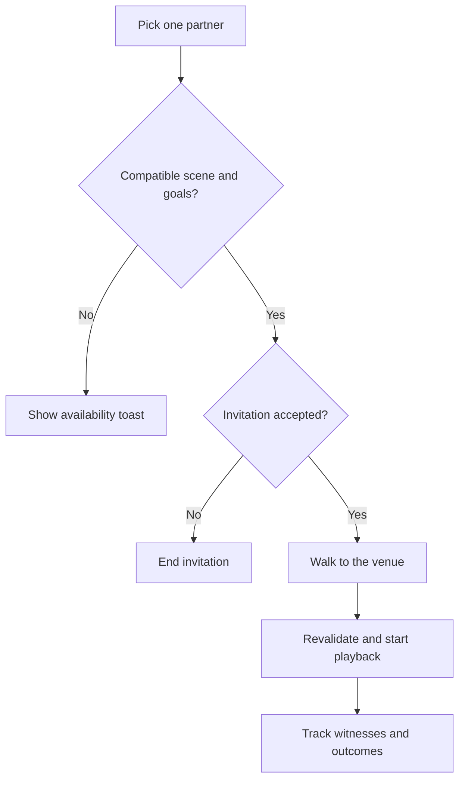

# HZoi Gameplay encounter design

**Status:** Proposed, iteration 1

HZoi Gameplay owns invitations, venue selection, witness reactions, and gameplay consequences. SceneZOI owns placement, playback, task progress, and cleanup. Installed content packs determine which pairs and venues can play a scene.

## Player interaction

Add **Have sex here** with a burning-heart icon to SceneZOI-supported beds and sofas and to walkable ground. Show it for a Young Adult or older initiator. Apply the same eligibility rule to picker candidates.

Keep eligibility in one configurable rule. Ghosts are handled through separate native life-state interfaces. Give supernatural states their own eligibility and compatibility checks. A future vampire can qualify through a verified adult stage even if aging is disabled, or through a configured mapping if a mod introduces a new adult stage. An unknown stage needs an explicit adult mapping. [Growth step enum](https://mod-docs.playinzoi.com/docs/modkit-docs/wiki/structguide/enum/eb1growthstep/) · [Life component](https://mod-docs.playinzoi.com/docs/modkit-docs/wiki/luaapi/b2/components/fb2lifecomponent/).

Open a picker patterned on SceneZOI’s debug starter. The initiator is fixed and the player selects one partner. Keep the roster representation compatible with more roles for later packs. The picker should return a selection without starting playback or causing the debug starter’s gameplay-group departures. [SceneZOI picker and group behavior](https://github.com/acepleiades/SceneZOI/blob/main/docs/group-support.md#solo-launcher-and-debug-picker).

### Content check and invitation

Resolve the actual roster, role bindings, and selected venue before the invitation. Require a compatible route to one `excitement` completion for each Zoi. The current content is expected to cover male/female pairs. Let male/male and female/female pairs reach the same check and show **No compatible scenes are available for these Zois at this spot** when no route exists. Content updates can enable those pairs without a gameplay rule change. Handle busy Zois, occupied furniture, and unreachable locations as temporary availability failures.

The initiator walks up and proposes the encounter using the **Set the Mood** conversation. Match the current build’s eligibility conditions, branch order, and acceptance/refusal weights from `Co_TryTo_Mood_Lover` and `Co_TryTo_Mood_Spouse`. Reuse the native social rules and approach dialogue. HZoi’s venue and adult-eligibility checks supply the equivalent context for ground and supported furniture. End the invitation on refusal. On acceptance, have both Zois walk to separate arrival points at the selected venue. Recheck eligibility, path arrival, and furniture availability before requesting playback. [Vanilla romance reference](inzoi-romance.md) · [Interaction branches](inzoi-romance-interactions.csv).

## Playback and consequences

Use `start_autonomous_scene` for both player- and NPC-initiated encounters. Request one `excitement` completion per participant, one stage, and `end_policy = {type = "goals"}`. Auto-mode already exits after both goals, authored completion responses, and any configured `post_completion_stay_seconds`. Manual takeover suspends planned exit. Keep the ordinary Exit control available. For furniture, pass `furniture_id` and the chosen `furniture_pair_id` for sofas. For ground, route the scene’s anchor-role Zoi to the clicked point. Current starts derive the ground anchor from a participant. Verify whether automatic placement adjustments stay within the chosen venue before deciding whether an explicit world anchor is needed. [SceneZOI start and plan API](https://github.com/acepleiades/SceneZOI/blob/main/docs/addons.md#autonomous-scenes).

| Verified completion count | Gameplay result |
| --- | --- |
| Both Zois completed once | Full success. Grant both a positive moodlet. |
| One Zoi completed once | Partial success. Grant that Zoi the positive moodlet. |
| Neither Zoi completed | Grant no completion moodlet. Record whether play ended, was interrupted, or failed to start. |

Correlate `session_started` with the original request. Read per-Zoi `plan.goals` and `result_facts.task_state` on `session_ended`, with `get_session_result` for a missed event. Apply rewards once after cleanup and keep the stop reason alongside the completion counts. A missing result leaves the outcome unknown. [SceneZOI outcomes](https://github.com/acepleiades/SceneZOI/blob/main/docs/addon-controls.md#observation-and-outcomes).

Add one urge for an encounter with a specific eligible Zoi. Store the target by entity ID. Decide the urge’s generation rate and expiration during tuning. Action-specific urges, needs adjustments, contraception, and pregnancy effects are outside the first implementation. Keep the per-Zoi outcomes available for later needs tuning.

## NPC initiation and witnesses

Let NPCs invite their established romantic partners through the same eligibility, content, and acceptance flow. Start with private residential rooms that both Zois can reach. Prefer available supported furniture, with suitable private ground as a fallback. Skip the attempt if neither exists. Independent pairs can proceed concurrently. Recheck shared participants and furniture at arrival so two invitations cannot claim the same Zoi or seat.

Check nearby loaded Zois during intimate playback, including anyone who arrives after the scene starts. A qualifying witness is outside the scene roster, on the same floor, within the configured range, and has a clear view of an intimate action. Use the current action and resolved participant IDs from `Client.actions(snapshot)`. Ordinary NPC witnesses react with surprise and prefer to walk away.

An official partner who witnesses a participant with another Zoi triggers **confirmed cheating detection**. Use named relationships for eligibility. The proposed initial set is `Youth_Lover`, engagement, and spouse, which covers the formal adult routes. Record the witness, their partner who was seen, the other participant, and the session ID. Deduplicate per session, witness, and involved partner. Capture the witness while the action is visible, before scene exit changes anyone’s position.

For iteration 1, an official-partner detection requests ordinary scene exit so the native reaction can run after cleanup. Call `OnReceiveHowling("Howling_Affair_Confirmed", involvedPartnerId)` on the **witness’s** Howling component. HZoi supplies the visibility and relationship checks and preserves the witness and involved-partner roles explicitly. Keep the confirmed HZoi incident if native delivery is refused, and report the failed handoff. Verify both the native flags and the relationship records before relying on this path. A full three-Zoi confrontation needs an additional verified handoff of the third participant. [SceneZOI witness integration](https://github.com/acepleiades/SceneZOI/blob/main/docs/addon-authoring.md#a-romantic-partner-catches-the-encounter) · [Native Howling API](https://mod-docs.playinzoi.com/docs/modkit-docs/wiki/luaapi/b2/components/fb2howlingcomponent/).

## First API probes

| Area | Probe and expected result |
| --- | --- |
| Content preflight | Negotiate `get_version`. Use `find_scenes`, `find_furniture`, and `validate_start` with `start_mode = "start_autonomous_scene"` and the real goal payload. Test a supported pair, an unsupported pair, and a compatible scene with an unreachable goal. Current preflight checks distance and returns `assets_checked = false`. Its response omits the route uncertainty reported by start. If this blocks the pre-invitation guarantee, expose a catalog-only goal-route check with route certainty and keep live placement checks at arrival. |
| Menu, dialogue, and walking | Check object and ground interaction hooks separately. Prototype the native picker look using the debug starter’s `UB1ZoiGroupEditUIHandler` approach. Test a custom `InteractionBag` and `Coop` for the approach and refusal, then verify native walking completes for both Zois before scene setup. [Coop action](https://mod-docs.playinzoi.com/docs/modkit-docs/wiki/luaapi/b2/actions/fb2action-coop/) · [WalkTo action](https://mod-docs.playinzoi.com/docs/modkit-docs/wiki/luaapi/b2/actions/fb2action-walkto/). |
| Results and rewards | Read `task_completed`, `session_ended`, and the recovered result for two, one, and zero completions. Test Auto-mode and the optional stay with a real completion response. Try `FB2BuffComponent:AddBuff` for the earned moodlet. Verify whether a native urge can store a partner ID. HZoi can own the target if the native urge cannot. [Buff component](https://mod-docs.playinzoi.com/docs/modkit-docs/wiki/luaapi/b2/components/fb2buffcomponent/). |
| Witness roles | Test a visible official partner, a partner behind an occluder, and an unrelated visible NPC. Verify the caught record and penalty belong to the involved partner, the witness record belongs to the observer, and repeated observations of the same event deliver once. |
| NPC venues and concurrency | Try a private bedroom, a public-room rejection, two independent pairs, and two pairs targeting the same sofa seats. Confirm losing attempts leave the active scene and its participants alone. |
